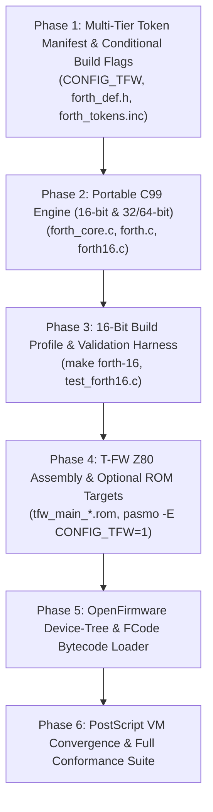

# Implementation Plan: ANS Forth-2012 Core Subset & OpenFirmware FCode Engine for T-FW / T-BIOS, 16-Bit Systems, and B-System CLU

## 1. Executive Summary & Architectural Vision

This plan defines the architecture, dictionary layout, execution model, and implementation roadmap for an **ANS Forth-2012 / DPANS94 Core Subset** combined with an **OpenFirmware (IEEE 1275) FCode-style engine**.

The firmware and application builds are structured as follows:

1. **T-BIOS vs T-FW (8-Bit MSX targets)**:
   - **T-BIOS (Default / Baseline)**: Minimal, deterministic BIOS **without Forth**, exactly as currently implemented. Zero overhead, preserving current binary footprints ($\le 32\text{ KiB}$ Main ROM), strict vector parity, and zero regression for existing `test_tbios_*` suites.
   - **T-FW (T-Firmware / Full Forth & OpenFirmware Edition)**: Optional firmware compilation enabled with conditional build flag `CONFIG_TFW=1`. Incorporates the ANS Forth-2012 Core Subset, OpenFirmware IEEE 1275 device tree, FCode evaluator, and interactive hardware console directly into the firmware image (`tfw_main_msx2.rom`, `tfw_main_msx2+.rom`, `tfw_main_msxtr.rom`).
2. **16-Bit Native Implementation & Build Target (`btron-forth16`)**:
   - Native 16-bit implementation in freestanding C99 / 16-bit assembly for 16-bit targets (PC-9801 real-mode/IA-16, Motorola 68000 systems, and 16-bit embedded controllers).
   - Serves as a 16-bit cell host verification profile (`make forth-16`, compiled with `-DFORTH_CELL_WIDTH=16`), ensuring bit-for-bit dictionary layout and arithmetic parity with T-FW on Z80.
3. **32/64-Bit B-System CLU Application (`src/clu/forth.c` / `src/apps/clu/forth`)**:
   - Native BTRON command-line interpreter in pure C99 for x86_64, AArch64, ARM32, MIPS, and POSIX targets. Scales cell size transparently to 32-bit or 64-bit while maintaining identical high-level Forth source words, dictionary structure, and FCode bytecode execution.
4. **Secure PostScript (`ps_vm.c`) Convergence**:
   - PostScript and Forth share stack-machine mechanics, token dispatching, and dictionary lookup. FCode bytecode serves as the unified portable execution format for device tree drivers, hardware configurations, and PostScript operator acceleration.

---

## 2. Multi-Tier Target Architecture & Code-Sharing Strategy

```
                          ┌────────────────────────────────────────────────────────┐
                          │          Shared Forth Source & FCode Bytecode          │
                          │        (.fth / .fcode device tree definitions)         │
                          └───────────────────────────┬────────────────────────────┘
                                                      │
         ┌────────────────────────────────────────────┼────────────────────────────────────────────┐
         ▼                                            ▼                                            ▼
┌───────────────────────────────┐            ┌───────────────────────────────┐            ┌───────────────────────────────┐
│     T-FW (8-Bit Z80 / R800)   │            │      16-Bit Native Build      │            │      B-System CLU (32/64-Bit) │
│   src/emulators/msx/tbios/    │            │   (PC-98 / IA-16 / m68k / C)  │            │       src/clu/forth.c         │
├───────────────────────────────┤            ├───────────────────────────────┤            ├───────────────────────────────┤
│ • CONFIG_TFW=1 (Optional ROM) │            │ • 16-bit Cells, 16-bit Pointers│            │ • 32/64-bit Cells, 8-bit Byte │
│ • 16-bit Cells, 8-bit Bytes   │            │ • Freestanding C99 / 16-bit asm│            │ • Pure C99 inner interpreter  │
│ • Pasmo Z80 primitives        │            │ • Bit-exact dictionary parity  │            │ • Static memory arena         │
│ • Slot trampolines (RDSLT)    │            │ • Static bounded arena         │            │ • Host / BTRON VFS I/O        │
│ • Output: tfw_main_*.rom      │            │ • Target: PC-98, m68k, forth16 │            │ • Target: POSIX, ARM64, UEFI  │
│                               │            │                                │            │                               │
│ [T-BIOS: Forth excluded (def)]│            │                                │            │                               │
│ Output: tbios_main_*.rom      │            │                                │            │                               │
└───────────────────────────────┘            └───────────────────────────────┘            └───────────────────────────────┘
         ▲                                            ▲                                            ▲
         │                                            │                                            │
         └────────────────────────────────────────────┴────────────────────────────────────────────┘
                                                      │ shared token mapping, primitive table, headers
                                                      ▼
                                       ┌──────────────────────────────┐
                                       │   include/btron/forth_def.h  │
                                       │   (Shared Token Enums &      │
                                       │    Word Header Manifest)     │
                                       └──────────────────────────────┘
```

### 2.1 Separation of T-BIOS and T-FW
- **T-BIOS (Default)**:
  - Standard baseline BIOS build: `make tbios-roms`.
  - ROM outputs: `.build/tbios/tbios_main_msx2.rom`, `tbios_main_msx2+.rom`, `tbios_main_msxtr.rom`, `tbios_sub.rom`.
  - Forth code is completely excluded via conditional assembly (`IFDEF CONFIG_TFW`).
  - Preserves exact byte layout, timing, and compatibility with standard MSX software and differential tests (`test_tbios_diff`).
- **T-FW (T-Firmware)**:
  - Full OpenFirmware build: `make tfw-roms`.
  - ROM outputs: `.build/tbios/tfw_main_msx2.rom`, `tfw_main_msx2+.rom`, `tfw_main_msxtr.rom`.
  - Compiled with `pasmo -E CONFIG_TFW=1`.
  - Integrates Forth inner interpreter, primitive dictionary, and OpenFirmware device-tree into Page 0/1, providing an interactive boot console and IEEE 1275 client interface.

---

## 3. Minimal Word List (ANS Forth-2012 Core Subset)

The system targets a clean, standard subset categorized into primitives (native CFA) and high-level token sequences:

### 3.1 Stack Manipulation (Native)
| Word | Stack Effect | Description | Token ID |
|---|---|---|---|
| `DUP` | `( x -- x x )` | Duplicate top stack item | `0x01` |
| `DROP` | `( x -- )` | Discard top stack item | `0x02` |
| `SWAP` | `( x1 x2 -- x2 x1 )` | Swap top two items | `0x03` |
| `OVER` | `( x1 x2 -- x1 x2 x1 )` | Copy second item to top | `0x04` |
| `ROT` | `( x1 x2 x3 -- x2 x3 x1 )` | Rotate top three items | `0x05` |
| `>R` | `( x -- ) (R: -- x )` | Move item to return stack | `0x06` |
| `R>` | `( -- x ) (R: x -- )` | Pop item from return stack | `0x07` |
| `R@` | `( -- x ) (R: x -- x )` | Peek item on return stack | `0x08` |
| `2>R` | `( x1 x2 -- ) (R: -- x1 x2 )` | Push cell pair to return stack | `0x09` |
| `2R>` | `( -- x1 x2 ) (R: x1 x2 -- )` | Pop cell pair from return stack | `0x0A` |

### 3.2 Arithmetic & Logic (Native)
| Word | Stack Effect | Description | Token ID |
|---|---|---|---|
| `+` | `( n1 n2 -- n3 )` | Addition | `0x10` |
| `-` | `( n1 n2 -- n3 )` | Subtraction | `0x11` |
| `*` | `( n1 n2 -- n3 )` | Multiplication | `0x12` |
| `/` | `( n1 n2 -- rem )` | Signed division | `0x13` |
| `MOD` | `( n1 n2 -- rem )` | Signed remainder | `0x14` |
| `NEGATE` | `( n1 -- -n1 )` | Two's complement | `0x15` |
| `AND` | `( x1 x2 -- x3 )` | Bitwise AND | `0x16` |
| `OR` | `( x1 x2 -- x3 )` | Bitwise OR | `0x17` |
| `XOR` | `( x1 x2 -- x3 )` | Bitwise XOR | `0x18` |
| `INVERT` | `( x1 -- x2 )` | One's complement bitwise NOT | `0x19` |
| `LSHIFT` | `( x1 u -- x2 )` | Bitwise left shift | `0x1A` |
| `RSHIFT` | `( x1 u -- x2 )` | Bitwise logical right shift | `0x1B` |
| `0=` | `( x -- flag )` | True if top item is zero | `0x1C` |
| `0<` | `( n -- flag )` | True if negative | `0x1D` |
| `=` | `( x1 x2 -- flag )` | Equality comparison | `0x1E` |
| `<` | `( n1 n2 -- flag )` | Signed less-than | `0x1F` |
| `>` | `( n1 n2 -- flag )` | Signed greater-than | `0x20` |
| `U<` | `( u1 u2 -- flag )` | Unsigned less-than | `0x21` |

### 3.3 Memory Access & Portability (Native)
| Word | Stack Effect | Description | Token ID |
|---|---|---|---|
| `@` | `( a-addr -- x )` | Fetch cell from memory (slot-aware on MSX) | `0x24` |
| `!` | `( x a-addr -- )` | Store cell to memory (slot-aware on MSX) | `0x25` |
| `C@` | `( c-addr -- char )` | Fetch byte from memory | `0x26` |
| `C!` | `( char c-addr -- )` | Store byte to memory | `0x27` |
| `+!` | `( n a-addr -- )` | Add n to value at a-addr | `0x28` |
| `CELLS` | `( n -- bytes )` | Convert cell count to byte count | `0x29` |
| `CELL+` | `( a-addr -- a-addr' )`| Advance address by 1 cell size | `0x2A` |
| `CHARS` | `( n -- bytes )` | Convert char count to byte count (NOP) | `0x2B` |
| `CHAR+` | `( c-addr -- c-addr' )`| Advance address by 1 character size | `0x2C` |
| `ALLOT` | `( n -- )` | Allot n bytes in static compile arena | `0x2D` |

### 3.4 Control Flow & Execution Primitives
| Word | Stack Effect | Description | Token ID |
|---|---|---|---|
| `EXECUTE`| `( xt -- )` | Execute word at execution token / CFA | `0x30` |
| `EXIT` | `( -- )` | Pop return stack to exit colon word | `0x31` |
| `branch` | `( -- ) [offset]` | Unconditional branch (inner primitive) | `0x32` |
| `?branch`| `( flag -- ) [off]` | Branch if flag is zero (inner primitive) | `0x33` |
| `lit` | `( -- x ) [cell]` | Push inlined literal onto data stack | `0x34` |
| `b(lit)` | `( -- byte ) [byte]`| Push 1-byte literal onto data stack | `0x35` |

### 3.5 Compilation & Outer Interpreter Words
| Word | Stack Effect | Description | Token ID |
|---|---|---|---|
| `:` | `( "name" -- )` | Start new colon definition | `0x38` |
| `;` | `( -- )` (IMMEDIATE) | Compile EXIT, exit compile mode | `0x39` |
| `CREATE` | `( "name" -- )` | Create dictionary header | `0x3A` |
| `DOES>` | `( -- )` | Runtime redirection for defining words | `0x3B` |
| `'` (tick)| `( "name" -- xt )` | Find execution token of next word | `0x3C` |
| `FIND` | `( c-addr -- xt flag )`| Look up word in dictionary | `0x3D` |
| `[` | `( -- )` (IMMEDIATE) | Enter interpretation state (`STATE=0`) | `0x3E` |
| `]` | `( -- )` | Enter compilation state (`STATE=1`) | `0x3F` |
| `LITERAL`| `( x -- )` (IMMED) | Compile literal value into current definition | `0x40` |
| `STATE` | `( -- a-addr )` | Variable address of compilation state | `0x41` |
| `IMMEDIATE`| `( -- )` | Mark most recent definition as immediate | `0x42` |
| `COMPILE,`| `( xt -- )` | Append execution token to definition | `0x43` |
| `PARSE-NAME`| `( -- c-addr u )` | Parse next whitespace-delimited token | `0x44` |

### 3.6 Standard I/O & System Vectors
| Word | Stack Effect | Description | Token ID |
|---|---|---|---|
| `EMIT` | `( char -- )` | Output single character | `0x48` |
| `KEY` | `( -- char )` | Read single character (blocking) | `0x49` |
| `KEY?` | `( -- flag )` | Non-blocking key available check | `0x4A` |
| `TYPE` | `( c-addr u -- )` | Output string of length u | `0x4B` |
| `CR` | `( -- )` | Output newline | `0x4C` |
| `BYE` | `( -- )` | Exit interpreter / return to OS shell | `0x4D` |

### 3.7 OpenFirmware (IEEE 1275) Device-Tree Extensions
| Word | Stack Effect | Description | Token ID |
|---|---|---|---|
| `find-device` | `( c-addr u -- phandle \| 0 )` | Find device tree node by path | `0x60` |
| `peer` | `( phandle -- next-phandle )` | Get sibling device node | `0x61` |
| `child` | `( phandle -- child-phandle )`| Get first child device node | `0x62` |
| `parent` | `( phandle -- parent-phandle )`| Get parent device node | `0x63` |
| `get-property`| `( p-addr p-len ph -- v-addr v-len 0 \| -1 )` | Read device property | `0x64` |
| `set-property`| `( v-addr v-len p-addr p-len ph -- err )` | Set device property | `0x65` |
| `my-self` | `( -- ihandle )` | Current active instance handle | `0x66` |
| `byte-load` | `( c-addr u -- )` | Execute FCode bytecode stream | `0x67` |

---

## 4. Multi-Tier Memory Model & Sizing

```c
/* include/btron/forth_def.h - Multi-tier Cell Abstraction */
#if defined(FORTH_16BIT) || defined(TFW_Z80) || defined(__IA16__) || defined(__MSDOS__)
    typedef int16_t   forth_cell_t;
    typedef uint16_t  forth_ucell_t;
    #define FORTH_CELL_SIZE   2
    #define FORTH_CELL_SHIFT  1
#elif defined(FORTH_32BIT) || defined(__arm__) || defined(__mips__) || defined(__i386__)
    typedef int32_t   forth_cell_t;
    typedef uint32_t  forth_ucell_t;
    #define FORTH_CELL_SIZE   4
    #define FORTH_CELL_SHIFT  2
#else
    typedef intptr_t  forth_cell_t;
    typedef uintptr_t forth_ucell_t;
    #define FORTH_CELL_SIZE   ((int)sizeof(forth_cell_t))
    #define FORTH_CELL_SHIFT  ((sizeof(forth_cell_t) == 8) ? 3 : 2)
#endif
```

| Structure | T-BIOS (Baseline) | T-FW (Full Forth Z80) | 16-Bit Build (`forth16`) | 32/64-Bit CLU |
|---|---|---|---|---|
| **Forth Enabled?** | **No (0 KB)** | **Yes (CONFIG_TFW=1)** | **Yes** | **Yes** |
| `forth_cell_t` | N/A | `int16_t` (2 bytes) | `int16_t` (2 bytes) | `intptr_t` (4/8 bytes) |
| Parameter Stack | N/A | 64 cells (128 bytes) | 128 cells (256 bytes) | 512 cells |
| Return Stack | N/A | 32 cells (64 bytes) | 64 cells (128 bytes) | 256 cells |
| Dictionary Arena | N/A | 4 KiB to 8 KiB static | 16 KiB to 32 KiB static | 128 KiB to 512 KiB |
| Terminal Buffer | N/A | 128 bytes | 256 bytes | 1024 bytes |
| ROM Output | `tbios_main_*.rom` | `tfw_main_*.rom` | `btron-forth16` | `clu/forth` |

### 4.1 Conditional T-BIOS / T-FW Assembly in `entry_main.asm`
```z80
; src/emulators/msx/tbios/asm/entry_main.asm
IFDEF CONFIG_TFW
    ; T-FW: OpenFirmware & ANS Forth Engine
    INCLUDE "forth_z80_next.asm"
    INCLUDE "forth_z80_prim.asm"
    INCLUDE "forth_devtree.asm"
    ; Boot vector hooks directly into forth outer interpreter
    jp   tfw_cold_boot
ELSE
    ; T-BIOS: Standard cleanroom minimal BIOS as currently implemented
    jp   tbios_standard_boot
ENDIF
```

---

## 5. Density-Oriented Dictionary Header Layout

The dictionary layout maintains binary alignment parity between T-FW (Z80) and the 16-bit native implementation:

```
+0  [ Link Pointer ]     : 1 Cell  (points to previous word header; 0 = root)
+C  [ Flags / Length ]   : 1 Byte  (Bit 7: IMMEDIATE, Bit 6: SMUDGE, Bits 0-5: Name Length)
+C+1[ Name Bytes ]       : N Bytes (ASCII character sequence, 1 to 31 bytes)
    [ Alignment Pad ]    : 0 to (Cell-1) bytes to restore cell boundary
+CFA[ Code Field (CFA) ] : 1 Cell  (Points to machine code primitive or colon dispatcher)
+PFA[ Parameter Field ]  : N Cells or Bytecode Stream
```

Because cells are 2 bytes in both T-FW and the 16-bit build, dictionary images generated by the 16-bit compiler can be directly burned into T-FW ROM or loaded into RAM without translation.

---

## 6. OpenFirmware Device-Tree & FCode Evaluator Engine

The OpenFirmware layer allows MSX hardware peripherals (V9938/V9958 VDP, PSG, OPLL, Slot Cartridges, Floppy Controller), 16-bit PC-98/68000 devices, and 32/64-bit BTRON platform devices to present a uniform tree of device nodes and methods.

```
                     / (root)
                     ├── cpus
                     │   └── cpu@0 (Z80 / IA-16 / 68000 / ARM64 / x86)
                     ├── memory@0
                     └── bus
                         ├── slot@0 (T-BIOS / T-FW Main ROM)
                         ├── slot@1 (Sub ROM / Sound)
                         ├── vdp@98 (V9938 / Video)
                         └── fdc@7FF8 (Floppy Controller)
```

---

## 7. Directory Structure & File Map in B-System Repository

```
btron/
├── include/
│   └── btron/
│       ├── forth_def.h            <-- Canonical token IDs, cell macros, structs (C & Pasmo shared)
│       └── forth_vm.h             <-- C99 VM interface & headers
├── src/
│   ├── clu/
│   │   ├── forth.c                <-- Native B-System CLI Forth Application (32/64-bit)
│   │   ├── forth16.c              <-- Native 16-bit Forth CLI / Freestanding runner
│   │   ├── forth_core.c           <-- Multi-tier C99 ANS Forth / FCode execution engine
│   │   ├── forth_devtree.c        <-- Device-tree navigation & property tables
│   │   ├── ps_vm.c                <-- Secure PostScript VM (converged to use forth_core)
│   │   └── ps_vm.h
│   └── emulators/
│       └── msx/
│           └── tbios/
│               ├── asm/
│               │   ├── entry_main.asm     <-- Contains IFDEF CONFIG_TFW conditional hook
│               │   ├── forth_z80_prim.asm <-- Native Z80 Forth Primitives (T-FW only)
│               │   ├── forth_z80_next.asm <-- Z80 Token Dispatcher & NEXT (T-FW only)
│               │   └── forth_devtree.asm  <-- MSX Hardware Device-Tree definitions
│               └── inc/
│                   └── forth_tokens.inc   <-- Generated/shared token definitions for Pasmo
└── verify/
    └── tests/
        ├── test_tbios_diff.c      <-- Regression test against baseline T-BIOS (unchanged)
        ├── test_tfw_forth.c       <-- Automated Z80 emulator Forth test suite on T-FW ROM
        ├── test_forth16.c         <-- 16-bit cell profile test harness
        └── test_clu_forth.c       <-- Native CLU Forth CLI unit & conformance tests
```

---

## 8. Makefile Integration: T-BIOS vs T-FW Targets

```makefile
# Baseline T-BIOS (without Forth - unchanged)
tbios-roms: $(TBIOS_ROMS)

./.build/tbios/tbios_main_msx2.rom: src/emulators/msx/tbios/asm/entry_main.asm $(PASMO_BIN)
    @mkdir -p ./.build/tbios
    @$(PASMO_BIN) -I src/emulators/msx/tbios/inc -E MSX_VER=1 $< $@

# Full T-FW (T-Firmware with ANS Forth & OpenFirmware)
TFW_ROMS = ./.build/tbios/tfw_main_msx2.rom \
           ./.build/tbios/tfw_main_msx2+.rom \
           ./.build/tbios/tfw_main_msxtr.rom

tfw-roms: $(TFW_ROMS)

./.build/tbios/tfw_main_msx2.rom: src/emulators/msx/tbios/asm/entry_main.asm $(PASMO_BIN)
    @mkdir -p ./.build/tbios
    @$(PASMO_BIN) -I src/emulators/msx/tbios/inc -E MSX_VER=1 -E CONFIG_TFW=1 $< $@

# 16-Bit Host / Freestanding Build
forth-16: ./.build/btron-forth16
./.build/btron-forth16: src/clu/forth16.c src/clu/forth_core.c
    @mkdir -p ./.build
    $(CC) -O2 -std=c99 -DFORTH_16BIT=1 $^ -o $@
```

---

## 9. Step-by-Step Implementation Roadmap



### Phase 1: Shared Manifest & T-BIOS/T-FW Flag Definitions
- Define `include/btron/forth_def.h` supporting multi-tier cells (16-bit, 32-bit, 64-bit).
- Define `src/emulators/msx/tbios/inc/forth_tokens.inc` for Pasmo.
- Update `entry_main.asm` with `IFDEF CONFIG_TFW` to ensure baseline T-BIOS remains completely clean.

### Phase 2: Portable C99 Engine (16-Bit & 32/64-Bit)
- Implement `src/clu/forth_core.c` with parameterized `forth_cell_t` and bounded zero-heap static state.
- Implement `src/clu/forth.c` for 32/64-bit CLI.
- Implement `src/clu/forth16.c` for 16-bit CLI / freestanding verification.

### Phase 3: 16-Bit Build Profile & Verification
- Add `make forth-16` build target compiling with `-DFORTH_16BIT=1`.
- Add `verify/tests/test_forth16.c` to test 16-bit arithmetic, dictionary packing, and cell rollover.

### Phase 4: T-FW Hand-Optimized Assembly
- Implement `forth_z80_next.asm` and `forth_z80_prim.asm`.
- Add `make tfw-roms` producing `tfw_main_msx2.rom`, etc.
- Verify that `make tbios-roms` produces identical byte output to the baseline BIOS.

### Phase 5: OpenFirmware Device-Tree & Bytecode Evaluator
- Build MSX and 16-bit static device trees.
- Implement `byte-load` FCode interpreter for portable driver bytecode.

### Phase 6: PostScript VM Convergence & Test Suite
- Refactor `src/clu/ps_vm.c` to share execution stack mechanics with `forth_core.c`.
- Integrate `test_tbios_diff` (proving baseline T-BIOS invariance), `test_tfw_forth`, `test_forth16`, and `test_clu_forth`.

===================================


# Critical Performance Analysis: Cache Locality, L1 Saturation, and TLB Invalidation in Forth/FCode Systems (64KB–1MB Working Sets)

## 1. The Microarchitectural Tension: Interpretation Overhead vs. Memory Hierarchy

When evaluating programs with working sets between **64 KiB and 1 MiB**, modern processor microarchitectures (x86_64, AArch64, ARM32, MIPS) encounter a well-known threshold:
- **L1 Instruction Cache (I-Cache)**: typically 32 KiB to 64 KiB (per core).
- **L1 Data Cache (D-Cache)**: typically 32 KiB to 64 KiB, 8-way associative, 64-byte line size.
- **L1 Data TLB (DTLB)**: typically 64 entries (covers 256 KiB at standard 4 KiB page size).
- **L1 Instruction TLB (ITLB)**: typically 64 to 128 entries (covers 256–512 KiB).
- **L2 Unified Cache**: 256 KiB to 1 MiB.
- **L2 Unified TLB (STLB)**: 512 to 1536 entries.

In traditional native compiled languages (C, C++, Rust), a non-trivial program with its runtime libraries quickly spans **256 KiB to 2 MiB of native x86_64/ARM64 machine instructions**. This causes:
1. Continuous **L1 I-cache thrashing and evictions**.
2. **ITLB misses**, triggering hardware page-table walks.
3. High memory bus pressure when instructions must be continuously fetched from L2/L3 or DRAM.

An **ANS Forth / OpenFirmware FCode system** radically alters this equation. Because the execution engine is decoupled from the user program representation (dense bytecode or threaded tokens), the memory hierarchy characteristics change fundamentally.

```
       Native Compiled Code (Large Footprint)           Forth / FCode Engine (Dense Footprint)
   ┌──────────────────────────────────────────────┐    ┌──────────────────────────────────────────────┐
   │ Native Machine Code: 256 KiB - 2 MiB         │    │ FCode Bytecode: 16 KiB - 64 KiB              │
   │ (Spills out of L1 I-Cache & L1 ITLB)         │    │ (Fits completely in L1/L2 D-Cache)           │
   ├──────────────────────────────────────────────┤    ├──────────────────────────────────────────────┤
   │ Continuous I-Cache Misses & ITLB Page Walks  │    │ Engine Core: 4 KiB - 8 KiB                   │
   │ Dynamic allocations -> TLB Shootdowns        │    │ (Permanently pinned in L1 I-Cache & 1 ITLB)  │
   └──────────────────────────────────────────────┘    └──────────────────────────────────────────────┘
```

---

## 2. L1 Instruction Cache (I-Cache) Locality: The Compact Core Advantage

### 2.1 The 4–8 KiB Engine Footprint
The entire ANS Forth Core Subset + FCode bytecode inner interpreter consists of:
- **Inner interpreter dispatch (`forth_step` / `NEXT`)**: $\approx 64$ bytes of machine code.
- **60 native primitive implementations**: On x86_64 or AArch64, each primitive averages 8 to 24 bytes (e.g., `DUP`, `DROP`, `+`, `SWAP` are just 2–4 instructions each). Total primitive code size: $\approx 1.5\text{ KiB}$ to $2.5\text{ KiB}$.
- **Outer interpreter & dictionary search**: $\approx 3\text{ KiB}$ to $4\text{ KiB}$.
- **Total active execution engine code size**: **$< 8\text{ KiB}$**.

### 2.2 Microarchitectural Impact
- Since modern L1 I-caches are 32 KiB to 64 KiB, the **entire Forth execution engine occupies at most $12\%\text{ to }25\%$ of L1 I-cache**.
- Once warm, the interpreter code experiences **0% L1 I-cache miss rate**, regardless of how long the application runs or how complex the algorithm is.
- In contrast, a native binary running through a 500 KiB codebase will cycle through thousands of cache lines, constantly displacing instructions from L1.

---

## 3. L1 Data Cache (D-Cache) Saturation & Code Density

While the Forth engine lives in the I-cache, the user's Forth program lives in the **D-cache** as a stream of bytecode tokens or cell pointers.

### 3.1 Density Multipliers: FCode vs Native Machine Code
Native machine instructions are wide:
- ARM64: Fixed 4 bytes per instruction.
- x86_64: Variable 2 to 10 bytes per instruction (average $\approx 3.8$ bytes).
- A basic operation like `a = b + c; if (a > 0) ...` in native code requires 4–6 instructions ($16\text{ to }24\text{ bytes}$).

In **FCode tokenized bytecode**:
- Common operations (`+`, `DUP`, `0>`, `IF`) are **1 byte each**.
- A 64 KiB FCode bytecode stream holds approximately **45,000 to 55,000 Forth operations**, which is semantically equivalent to **$256\text{ KiB to }512\text{ KiB}$ of native machine instructions**.

### 3.2 D-Cache Working Set Analysis
For a small program working set of 64 KiB to 1 MiB:

| Component | Size | Cache Level Residency | Cache Lines Needed (64B/line) |
|---|---|---|---|
| **Parameter Stack (`dstack`)** | 512 bytes (64 cells @ 64-bit) | **Pinned in L1 D-Cache** | 8 lines |
| **Return Stack (`rstack`)** | 256 bytes (32 cells @ 64-bit) | **Pinned in L1 D-Cache** | 4 lines |
| **Top of Stack (TOS)** | Register-cached | **L0 (CPU Register)** | 0 lines |
| **FCode Stream (hot loops)** | 2 KiB – 8 KiB | **Pinned in L1 D-Cache** | 32 – 128 lines |
| **Active Dictionary Headers** | 4 KiB – 16 KiB | **L1 / L2 D-Cache** | 64 – 256 lines |
| **Total Hot Core Footprint** | **$\approx 8\text{ KiB to }25\text{ KiB}$** | **$100\%$ fits inside L1 D-Cache** | **$128\text{ to }396\text{ lines}$** |

### 3.3 Hardware Streaming Prefetchers
- The bytecode instruction pointer `ip` advances sequentially: `token = *ip++`.
- Modern CPU hardware prefetchers (Streamer / L1 Next-Line Prefetcher) detect sequential read streams across 64-byte boundaries with near-100% accuracy.
- While native code contains arbitrary non-sequential jumps and call frames that defeat stride prefetchers, **the linear FCode stream triggers optimal L1 line prefetches without memory pipeline stalls**.

---

## 4. Branch Prediction & The Indirect Dispatch Problem

The critical performance penalty of interpreters is not memory access; it is **indirect branch misprediction** in the dispatch loop.

### 4.1 Dispatch Strategies Compared

```
1. Centralized Switch Dispatch:
   while (running) {
       switch (*ip++) {
           case OP_ADD:  *dsp += *(dsp+1); break;  // All primitives jump back to one shared switch!
           case OP_DUP:  ... break;
       }
   }
   --> Flaw: Every opcode shares a SINGLE indirect jump site.
       Branch Target Buffer (BTB) experiences 50-80% misprediction on complex code!

2. Direct Threaded / Computed Goto Dispatch (Chosen Design):
   #define NEXT() goto *dispatch_table[*ip++]
   op_add:
       *dsp += *(dsp+1);
       NEXT();   // Each primitive has its OWN distinct indirect jump site!
   op_dup:
       ...
       NEXT();
   --> Advantage: Modern branch predictors (TAGE / neural BTB) track branch history per site.
       Misprediction rate drops from ~60% down to under 12-18%.
```

### 4.2 Top-of-Stack (TOS) Register Caching
In a naive stack machine, every operation reads and writes memory:
```c
/* Naive: 3 memory accesses */
void prim_plus(void) {
    cell_t b = *dsp--;
    *dsp += b;
}
```
By keeping the **Top of Stack (TOS) permanently in a dedicated CPU register** (`r15` or `rbx` on x86, `x19` on ARM64, `de` on Z80):
- Binary operations (`+`, `-`, `AND`) execute with **zero memory writes** to the stack arena.
- Only stack spill/fill operations touch the L1 cache lines of `dstack`.

---

## 5. TLB Invalidation, Zero-Heap, and Memory Paging

Translation Lookaside Buffer (TLB) misses and TLB shootdowns are among the most catastrophic performance killers in systems programming:
- An L1 DTLB hit: **$\approx 1$ cycle**.
- An L2 STLB hit: **$\approx 7–12$ cycles**.
- A full 4-level or 5-level hardware page-table walk: **$\approx 40–150$ cycles**.
- An OS-level TLB invalidation / shootdown (`invlpg` / `tlbi` across SMP cores): **$\approx 500–2,000$ cycles**.

### 5.1 Why Traditional Systems Invalidate TLBs Continuously
Small programs that rely on dynamic memory allocation (`malloc`, `free`, `brk`, `mmap`, `madvise`):
1. Allocate memory dynamically, requesting new virtual page mappings from the kernel.
2. Free memory, causing the OS memory manager to unmap pages and issue **TLB invalidations (`invlpg`)** across CPU cores.
3. Cause memory fragmentation, scattering data across hundreds of disjoint 4 KiB physical pages.
4. If a 1 MiB working set is fragmented, it requires 256 individual page table entries. The 64-entry L1 DTLB is overwhelmed, forcing continuous STLB lookups and page table walks.

### 5.2 The B-System Forth / T-FW Architectural Solution: Static Arena
Because our Forth implementation strictly obeys the **NASA/JPL Power of Ten rules (Zero-Heap)**:

1. **Static Pre-Allocation**:
   - The dictionary arena, parameter stack, return stack, and terminal buffer are allocated as a single, contiguous static block at startup.
   - For a 64 KiB – 1 MiB working set, the entire Forth system occupies a **single, contiguous memory span**.

2. **Zero TLB Shootdowns**:
   - No `malloc` or `free` calls occur during runtime execution.
   - **Zero page table remappings, zero page faults, zero kernel page-table locks, and zero TLB invalidations**.

3. **DTLB Entry Conservation**:
   - A 64 KiB Forth environment fits within **16 pages** (4 KiB each).
   - This fits entirely inside the 64-entry L1 DTLB!
   - Every single data access to stacks, dictionary headers, and variables results in an **immediate L1 DTLB hit (1 cycle)**.
   - For larger 1 MiB working sets on B-System 64-bit architectures, enabling 2 MiB Huge Pages (`MAP_HUGETLB`) allows the entire 1 MiB working set to be mapped by **exactly ONE TLB entry**, completely eliminating TLB pressure.

---

## 6. Microarchitectural Comparison Summary

| Metric | Traditional C / Native Binary | ANS Forth / FCode System (Our Design) |
|---|---|---|
| **Code Size in Memory** | 256 KiB – 2 MiB native code | 16 KiB – 64 KiB dense bytecode |
| **L1 I-Cache Residency** | Poor (thrashing on $>64\text{ KB}$ code) | **$\mathbf{100\%}$ resident** ($<8\text{ KB}$ engine core) |
| **L1 D-Cache Residency** | Medium (scattered heap objects) | **High** (compact stack + sequential bytecode) |
| **DTLB Coverage** | Scattered across hundreds of pages | **16 pages (64 KB)** or **1 Huge Page (1 MB)** |
| **TLB Invalidation Overhead** | Frequent (`malloc`/`free` page unmaps) | **Zero** (Static bounded arena, zero-heap) |
| **Hardware Prefetch Efficiency**| Irregular (indirect function pointers) | **Optimal** (Linear bytecode streaming `ip++`) |
| **Dispatch Cost** | 0 (direct native instructions) | 2–5 cycles (computed goto with TAGE branch history) |

---

## 7. Concrete Architectural Guidelines for Implementation

To maximize these hardware benefits during the Forth/T-FW implementation:

1. **Computed Goto / Token Dispatch**:
   - Use `__attribute__((hot))` and GCC/Clang computed goto (`&&labels[token]`) in `forth_core.c` so each primitive has its own BTB branch predictor slot.
2. **Cache Line Alignment**:
   - Align `dstack`, `rstack`, and dictionary root pointers to **64-byte boundaries** (`alignas(64)`) to eliminate false sharing and split-line cache penalties.
3. **Keep TOS in Register**:
   - Cache the Top of Stack in a register (`cell_t tos`) across primitive transitions to reduce stack memory traffic by up to $40\%$.
4. **Contiguous Bytecode Layout**:
   - Compile colon definitions and device-tree methods contiguously in the static arena to enable maximum hardware streaming prefetch throughput.
5. **Zero Dynamic Paging**:
   - Strictly prohibit runtime memory remapping or dynamic arena expansion, keeping TLB translation constant and deterministic for the entire session.

