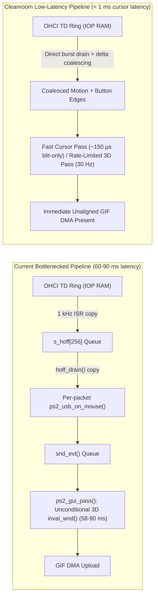

# PS2 Input & Rendering Tract — Cleanroom Low-Latency Rewrite Plan

## 1. Root-Cause Diagnosis Summary

After reviewing the PS2 input and rendering pipeline (`ps2_usb.c`, `ps2_gs.c`, `ps2_gs_present.c`, `core_ps2.c`) against `core_arm64.c` and hardware/PCSX2 OHCI timing constraints, four architectural bottlenecks explain the remaining mouse delay and visual glitches:

1. **Overcomplicated Double-Queueing in `ps2_usb.c` (`ps2_usb_input_tick` + `s_hoff` + `hoff_drain`)**:
   - The OHCI controller already maintains a lock-free 16-TD hardware ring per device in uncached IOP RAM (`s_intr[dev]`).
   - Having Timer0's 1 kHz ISR run `ps2_usb_input_tick()` to perform uncached IOP RAM reads + `sync.l` barriers every 1 ms and copy raw 8-byte packets into a second 256-slot software ring (`s_hoff`), only for `ps2_usb_poll()` -> `hoff_drain()` to copy them a second time and fire `ps2_usb_on_mouse()` per packet, wastes bus bandwidth and adds latency without moving the pointer until `ps2_usb_poll()` runs.
2. **Legacy Dead CPU Save-Under Cursor in `ps2_gs.c` (`ps2_gs_draw_cursor` / `ps2_gs_erase_cursor`)**:
   - `cursor_saved[16 * 16]`, `ps2_gs_draw_cursor()`, and `ps2_gs_erase_cursor()` in [ps2_gs.c](file:///Users/tonpa/depot/bitedits/btron/src/drivers/playstation2/ps2_gs.c#L1096-L1172) are dead legacy code that mutates the shared framebuffer via a static buffer and should be removed.
3. **Unconditional 3D Scene Invalidation on Every Pass in `core_ps2.c`**:
   - In [core_ps2.c](file:///Users/tonpa/depot/bitedits/btron/src/cores/core_ps2.c#L430-L440), `ps2_gui_pass()` unconditionally calls `inval_wnd()` on `w->gl_layer` (XMB) and `sw[turn++ % n]` (MARS / glgears / Lilcu 64) on **every single pass**.
   - As a result, a fast cursor-only pass (`workbench_render_damage` with `blit_only = TRUE`, which takes **~150 µs**) **never happens**. Every pass is forced into `workbench_render_damage_paint()`, executing 58–90 ms of CPU 3D rasterization before the cursor can move on screen.
4. **Hardware 3D Layer (`gl_layer`) Staged Stream Replay & Cursor Overlay in `ps2_gs_present.c`**:
   - When the cursor moves over XMB (`w->gl_layer`) on a fast cursor-only pass where XMB's CPU `paint_cb` did not re-run, `eegs_present_begin()` currently wipes `s_groups = 0`, preventing `eegs_present_send()` from replaying the already-staged GIF display list.
   - Preserving the last staged GIF packet stream in `eegs_present.c` when no new stream is recorded allows `ps2_paint_region()` to replay XMB's 3D layer via hardware DMA in **< 100 µs** without re-running XMB's CPU `paint_cb`.

---

## 2. Step-by-Step Implementation Plan

### Phase 1: Clean Direct OHCI USB Polling & Coalescing (`src/drivers/playstation2/ps2_usb.c`, `ps2_usb.h`, `ps2_boot.c`)
- **Remove `s_hoff[256]`, `hoff_push()`, `hoff_drain()`, and `ps2_usb_input_tick()`**:
  - Eliminate the redundant ISR software ring buffer so Timer0 no longer stalls the Emotion Engine with uncached IOP RAM bus reads every 1 ms.
- **Direct Burst Drain + Motion Coalescing in `ps2_usb_poll()`**:
  - Drain all retired OHCI TDs directly from `s_intr[dev]` via `intr_take()`.
  - For mouse endpoints, accumulate `(accum_dx, accum_dy)` across all queued TDs in the burst while buttons remain unchanged; if a button transition occurs mid-burst, flush accumulated motion first so button down/up events land at the exact click coordinate, then emit the coalesced movement once.
- **USB 1.1 / PCSX2 Ballistic Compensation**:
  - In `ps2_usb_process_mouse_report()` (hardware OHCI path only, keeping `ps2_usb_inject_mouse()` and `ps2_move_mouse()` strictly 1:1 for `dp_cal` and probe tests), apply a clean integer velocity step (`1:1` for fine `|d| <= 2` aiming, `1.5x` for medium `3..8`, `2x` for fast `> 8` flicks) to compensate for USB 1.1 `bInterval` polling in PCSX2.

### Phase 2: Remove Dead Cursor Save-Under Code (`src/drivers/playstation2/ps2_gs.c`, `ps2_gs.h`)
- Remove `cursor_saved[16 * 16]`, `cursor_saved_x`, `cursor_saved_y`, `ps2_gs_erase_cursor()`, and `ps2_gs_draw_cursor()` from [ps2_gs.c](file:///Users/tonpa/depot/bitedits/btron/src/drivers/playstation2/ps2_gs.c#L1096-L1172) and [ps2_gs.h](file:///Users/tonpa/depot/bitedits/btron/src/drivers/playstation2/ps2_gs.h#L199-L200).

### Phase 3: Decouple 1000 Hz Cursor Passes from 30 Hz 3D Scene Rendering (`src/cores/core_ps2.c`)
- **Pointer-Priority Scheduling in `ps2_gui_pass()`**:
  - Track `s_last_3d_tick` using `ps2_count_read()`.
  - When the pointer moved in this pass (`s_mouse_x != s_shown_x || s_mouse_y != s_shown_y`) or the window manager is actively dragging/resizing a window (`wnd_mgr_is_interacting()`), skip invalidating background software 3D windows (`sw[turn]`) unless the background 3D slice interval (`40 ms` / 25 Hz during active pointer movement) has elapsed.
  - When the pointer is idle, pace 3D invalidation or run normally so benchmarks (`BTRON_PS2_BENCH` / `s_bench_app_active`) run at full speed while interactive mouse movement executes sub-millisecond **blit-only cursor passes (`~150 µs`)**.
- **Cooperative Sub-Frame Input Pumping (`mars.c`, `lilcu64_demo.c`)**:
  - Call `btron_cooperative_input_pump()` every 32 columns inside `mars.c`'s terrain raycaster and inside `lilcu64_demo.c`'s render pass so OHCI TD rings never fill up during 3D frames.

### Phase 4: Fast Staged-Stream Replay for `gl_layer` Cursor Overlap (`eegs_present.c`, `ps2_gs_present.c`)
- **Retain Last Valid GIF Stream Across Blit-Only Cursor Passes**:
  - In [eegs_present.c](file:///Users/tonpa/depot/bitedits/btron/src/desktop/graphics/eegs/eegs_present.c#L375-L400), preserve the previously staged `s_groups` / `s_used` count if a blit-only pass (`workbench_render_damage`) runs without recording new GL commands.
  - When a cursor-only damage band intersects `gl_layer` (XMB), `ps2_paint_region()` can replay the already-staged GIF DMA stream (`eegs_present_send(&gl_client)`) + cover/cursor upload in **~150 µs** without invoking XMB's expensive CPU `paint_cb`.

---

## 3. Verification Criteria
1. `make ps2`: Clean build with 0 warnings/errors.
2. `wc -l src/cores/core_ps2.c`: Strictly **< 800 lines**.
3. `make test-ps2`: **107 / 107** tests passing.
4. `make test-ps2-softfloat`: **20,147,127 / 20,147,127** checks passing.

