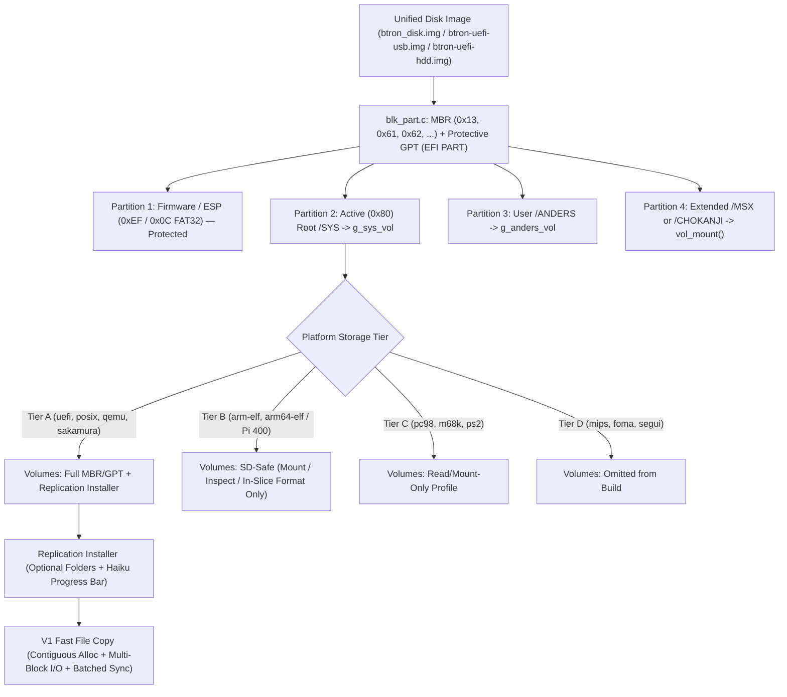
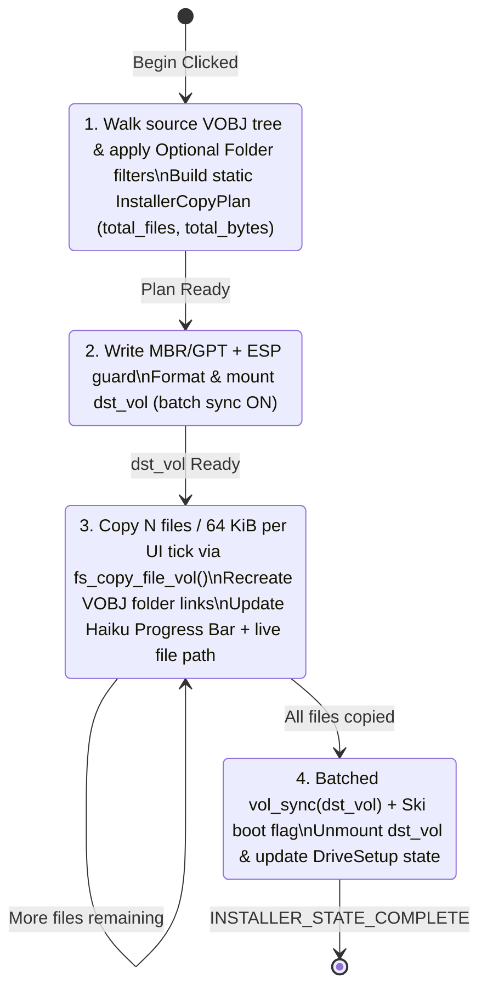

# Unified Multi-Partition Disk Boot Model & Replication Installer — Implementation Plan

This plan translates the boot architecture and target analysis documented in [Boot.html](file:///Users/tonpa/depot/bitedits/btron/apps/Boot.html) into an incremental engineering rollout across three integrated tracks:

- **Part 0 (Cross-Cutting Foundation):** Establish a normative **BTRON OS Error Code Protocol** grounded in [error.h](file:///Users/tonpa/depot/bitedits/btron/include/btron/error.h) across the block/partition layer, V1 filesystem copy engine, Ski/core boot path, and Volumes/Installer UI — eliminating ad-hoc `-1` / silent `bool` failures.
- **Part I (Phases 1–5):** Transition B-System to direct boot from unified **Disk-Based Multiple Partition Images** (MBR & GPT), make **UEFI always boot from `.img` disk images** (with direct `.vol` partition-slice granularity strictly **optional**), and right-size `Volumes` ([b_drivesetup.c](file:///Users/tonpa/depot/bitedits/btron/src/apps/volumes/b_drivesetup.c)) to each platform's physical storage tier.
- **Part II (Phases 6–8):** Mature the **B-FS V1 file copy operation** to production speed and correctness, introduce a reusable **Haiku-style progress bar control** showing live file paths during copy, and replace the Installer's raw block-clone loop with a **concise, folder-aware replication architecture**.

> [!IMPORTANT]
> **Invariants Preserved Throughout All Phases:**
> 1. **NASA/JPL Rule 3:** No post-boot `malloc`/`free` in freestanding partition scanning (`s_part_dev[MAX_PART_DESCS]` static pool in [blk_part.c](file:///Users/tonpa/depot/bitedits/btron/src/fs/blk_part.c)), V1 multi-block copy buffers, error formatting, or Installer copy manifests.
> 2. **UEFI Disk-First Policy & Optional `.vol` Slice Granularity:** After refactoring, UEFI (Target 4) always boots from partitioned `.img` disk images; booting standalone `.vol` partition slices is an optional finer-granularity mode (`BTRON_ALLOW_VOL_BOOT` / `slice_boot=1`).
> 3. **Normative `ER` Propagation:** Every fallible OS boundary returns a typed BTRON `ER` code (`E_OK == 0`, `< 0` on error) with atomic rollback of partial allocations on failure.
> 4. **Tree Structure Rules:** All edits comply with [test_structure.sh](file:///Users/tonpa/depot/bitedits/btron/scripts/test_structure.sh) (single `main()` per target, single libc mapping in `libc_shim.h`, and `.nocache` alignment).

---

## Architecture Overview



---

## Part 0: OS Error Code Protocol Design (Cross-Cutting Foundation)

Currently, [error.h](file:///Users/tonpa/depot/bitedits/btron/include/btron/error.h) defines the normative BTRON 3.20 `ER` base codes (`E_OK`, `E_PAR`, `E_LIMIT`, `E_NOEXS`, `ER_IO`, `ER_NOSPC`, `ER_NODSK`, `ER_NOFS`, `ER_RONLY`, etc.), while `file.c`, `blk_part.c`, `b_drivesetup.c`, and `b_installer.c` frequently return untyped `-1`, `NULL`, or `false`. Because storage, boot, filesystem copy, and installation are safety-critical OS boundaries, we will standardize a single **BTRON Error Code Protocol** across all layers.

### 1. Canonical Error Ranges (`include/btron/error.h`)

Reuse all standard BTRON 3.20 base codes (`-1` .. `-69`) where semantics match (`E_PAR`, `ER_IO`, `ER_NODSK`, `ER_NOSPC`, `ER_NOFS`, `ER_RONLY`, `ER_FNAME`, `ER_EXS`, `ER_PERM`, `ER_OVRW`), and reserve clean, non-overlapping subsystem bands (`-501` .. `-559`, following existing subsystem conventions: `font_mgr.h` `-2xx`, `omgr.h` `-3xx`, `tcpip.h` `-4xx`):

| Subsystem Band | Code Name | Value | Meaning / Trigger Condition |
| :--- | :--- | :---: | :--- |
| **Partition & Disk (`-501..-519`)** | `ER_PART_NOMBR` | `-501` | Disk LBA 0 lacks valid `0x55AA` MBR boot signature |
| | `ER_PART_BADGPT` | `-502` | Protective MBR (`0xEE`) found, but LBA 1 `"EFI PART"` header/CRC invalid |
| | `ER_PART_NOTFOUND` | `-503` | Requested BTRON partition slot/type/GUID does not exist |
| | `ER_PART_POOLFULL` | `-504` | Static `s_part_dev[MAX_PART_DESCS]` pool exhausted (Rule 3 bound) |
| | `ER_PART_READONLY` | `-505` | Partition table protected by platform tier (Tier B SD-Safe / Tier C / `.vol` slice) |
| | `ER_PART_OVERLAP` | `-506` | Requested partition LBA range overlaps ESP or an existing partition |
| | `ER_PART_SLICE_DIS` | `-507` | Direct `.vol` slice boot disabled on UEFI (`BTRON_ALLOW_VOL_BOOT` / `slice_boot=1` not enabled) |
| **B-FS V1 & Copy (`-520..-539`)** | `ER_FS_BADMAGIC` | `-520` | Unrecognized volume superblock magic (`0x42FE` / `0x52FE` / `0x62FE`) |
| | `ER_FS_CORRUPT` | `-521` | Inconsistent FID table, FileHeader block, or RecordIndex bounds |
| | `ER_FS_FRAG` | `-522` | Free blocks exist, but no contiguous extent of requested size is available |
| | `ER_FS_NOFID` | `-523` | Volume FID table full (`nfmax` slots exhausted) |
| | `ER_FS_COPY_TRUNC` | `-524` | Short read/write during multi-block copy transfer |
| | `ER_FS_LINK_CYCLE` | `-525` | VOBJ directory link cycle detected during recursive walk |
| **Installer & Replicator (`-540..-559`)** | `ER_INST_NOSRC` | `-540` | No valid mounted source volume selected |
| | `ER_INST_NODST` | `-541` | No valid destination disk/partition selected |
| | `ER_INST_SAMEDEV` | `-542` | Source and destination resolve to the same volume/partition |
| | `ER_INST_TOOSMALL` | `-543` | Destination partition capacity is smaller than planned replication payload |
| | `ER_INST_PLANFULL` | `-544` | Source tree exceeds static `INSTALLER_MAX_COPY_ITEMS` bound |
| | `ER_INST_CANCELLED` | `-545` | User cancelled replication cleanly mid-flight |
| | `ER_INST_BOOTFLAG` | `-546` | Failed to commit Ski/MBR active `0x80` boot flag or ESP guard |

### 2. Zero-Allocation Diagnostic & Propagation Contract

#### [MODIFY] [error.h](file:///Users/tonpa/depot/bitedits/btron/include/btron/error.h)
- Add `static inline const char *btron_err_name(ER err)` (returns symbolic name e.g. `"ER_PART_READONLY"`, `"ER_NODSK"`) and `static inline const char *btron_err_str(ER err)` (returns concise human-readable message for UI status bars and UART logs) — zero heap, safe in both freestanding kernels and hosted unit tests.
- **4-Layer Propagation Rules:**
  1. **Block & Partition Layer (`blk_part.c`):** Pointer-returning finders add `_ex(..., ER *out_err)` variants (keeping existing wrappers binary/source-compatible), and `blk_mount_disk_partitions()` returns `ER` (`>= 0` mounted count or `< 0` `ER_*`).
  2. **Filesystem & Copy Layer (`vol.c`, `file.c`):** `vol_read_blks`, `vol_write_blks`, `ins_rec`, `fs_copy_file_vol`, `fs_add_vobj_link_vol`, and `cpy_fil` return normative `ER` codes (replacing raw `-1`/`-5`) and guarantee **atomic rollback** (`vol_free_block` + `vol_fid_free`) if any mid-copy I/O or space allocation fails.
  3. **Boot & Core Layer (`core_boot.c`, `core_posix.c`, `core_arm64.c`, etc.):** All mount/probe failures log a uniform wire format over UART/stderr:
     `[SUBSYS] <op> failed: <btron_err_name(er)> (<er>) - <btron_err_str(er)>`
  4. **UI & Application Layer (`b_drivesetup.c`, `b_installer.c`):** Store `ER last_err` in `DriveSetupState` and `InstallerState`. Format user-facing `status_msg` / `error_msg` from `btron_err_str(st->last_err)` plus `btron_err_name(st->last_err)` so end-users see actionable diagnostics and unit tests assert exact `ER` codes rather than fragile prose substrings.

---

## Part I: Unified Multi-Partition Disk Boot Model & Storage Tiers

### Phase 1: MBR/GPT Multi-Partition Scanner & Unified Storage Helper

#### [MODIFY] [block.h](file:///Users/tonpa/depot/bitedits/btron/include/fs/block.h) & [blk_part.c](file:///Users/tonpa/depot/bitedits/btron/src/fs/blk_part.c)
- **Broaden recognized BTRON MBR partition type codes:** Add `blk_is_btron_mbr_type(uint8_t type)` accepting `0x13` (Chokanji / B-right/V), `0x61` (B-FS V1), `0x62` (B-FS V2), `0xB3..0xB5` (Signed B-FS), and `0xE1..0xE4` (Encrypted B-FS).
- **Add Protective GPT support (zero-heap, static sector buffer):**
  - When LBA 0 has MBR signature `0x55AA` and an entry has type `0xEE` (Protective MBR), read LBA 1 and verify `"EFI PART"` (`0x5452415020494645`).
  - Walk GPT partition entries (up to 128 entries, 128 bytes each, 4 entries per 512-byte sector starting at `partition_entry_lba`) and match BTRON Type GUIDs (`BTRON_GPT_GUID_CHOKANJI`, `BTRON_GPT_GUID_BFS_V1`, `BTRON_GPT_GUID_BFS_V2`).
  - Expose `blk_gpt_find_btron_partition_idx(BlkDev *dev, int target_idx, UW fs_block_size)` and route `blk_mbr_find_btron_partition_idx()` to delegate to GPT scanning automatically when Protective MBR (`0xEE`) is detected.
- **Unify superblock magic probing (`+0` and `+8` sector IPL offset):** Support `0x42FE` (B-FS V1 BE), `0x52FE` (B-right/V LE), and `0x62FE` (B-FS V2) uniformly across MBR and GPT slices.
- **Add unified multi-partition mount helper:** Provide `int blk_mount_disk_partitions(BlkDev *disk_512, int preferred_slot)` that:
  1. Probes `preferred_slot` first (if `>= 0`) and mounts it as `g_sys_vol` (`/SYS`).
  2. Iterates remaining BTRON partitions on `disk_512`, inspects `VolumeHeader.vol_name`, assigning `"SYS"` / active slot to `g_sys_vol`, `"ANDERS"` to `g_anders_vol`, and registering any additional volumes (`"MSX"`, `"CHOKANJI"`, etc.) in `vol.c`'s mounted volume registry.

---

### Phase 2: Unified Multi-Partition Disk Image Builder & Makefile Integration

#### [MODIFY] [mk_uefi_storage.py](file:///Users/tonpa/depot/bitedits/btron/scripts/mk_uefi_storage.py)
- Add a `disk` command (included in `all`) generating `btron_disk.img` (64 MiB raw disk image with MBR by default, or GPT via `--gpt`):
  - **Partition 1 (Slot 0, LBA 2048, 8 MiB):** ESP (`0xEF`).
  - **Partition 2 (Slot 1, LBA 18432, 24 MiB, Active `0x80`):** BTRON `/SYS` (`0x13`, populated from `btron_sys.vol`).
  - **Partition 3 (Slot 2, LBA 67584, 24 MiB):** BTRON `/ANDERS` (`0x13`, populated from `btron_anders.vol`).
- Ensure `build_btron_volumes()` prefers up-to-date root `btron_sys.vol` and `btron_anders.vol` when present so disk images never drift from `Makefile`-built volumes.

#### [MODIFY] [Makefile](file:///Users/tonpa/depot/bitedits/btron/Makefile)
- Add a `btron_disk.img` target depending on `btron_sys.vol`, `btron_anders.vol`, and `scripts/mk_uefi_storage.py`.
- Wire `btron_disk.img` as the primary boot disk prerequisite for `posix`, `run-posix`, `qemu`, `run-qemu`, `sakamura`, `run-sakamura`, and `foma` / `run-foma`.
- Ensure all UEFI targets (`run-uefi`, `run-uefi-usb`, `run-uefi-hdd`, `run-uefi-cd`) **always** attach partitioned `.img` disks (`btron-uefi-usb.img`, `btron-uefi-hdd.img`, `btron_disk.img`) and never rely on standalone `.vol` slices.

---

### Phase 3: Core Startup, UEFI Disk-Only Boot & Optional `.vol` Slice Mode

#### [MODIFY] [core_boot.c](file:///Users/tonpa/depot/bitedits/btron/src/cores/core_boot.c) (Target 4: `uefi`)
- **Enforce `.img` Disk-Only Boot on UEFI by Default:**
  - `btron_storage_probe_and_mount()` and `ski_init_targets()` always scan partitioned VirtIO `.img` disks (MBR all BTRON types `0x13`, `0x61`, `0x62`, `0xB3..0xB5`, `0xE1..0xE4` + Protective GPT `0xEE` -> `"EFI PART"`).
  - Do **not** mount or boot raw unpartitioned `.vol` slices on UEFI unless the explicit slice-granularity flag (`BTRON_ALLOW_VOL_BOOT` or Multiboot cmdline `slice_boot=1`) is enabled.
- **Sibling Partition Auto-Mount on Ski Selection:**
  - After mounting the user-selected boot partition as `g_sys_vol` (`/SYS`), automatically mount sibling BTRON partitions on that same disk (e.g., `/ANDERS`, `/MSX`) and cleanly replace any stale mount from a different disk when switching boot targets in Ski.

#### [MODIFY] [core_posix.c](file:///Users/tonpa/depot/bitedits/btron/src/cores/core_posix.c), [core_virtio.c](file:///Users/tonpa/depot/bitedits/btron/src/cores/core_virtio.c), [core_tkernel.c](file:///Users/tonpa/depot/bitedits/btron/src/cores/core_tkernel.c), [core_foma.c](file:///Users/tonpa/depot/bitedits/btron/src/cores/core_foma.c) (Targets 0, 1, 3, 10)
- In each core's `btron_core_hfds_log()`:
  1. **Primary path (Unified Disk Image):** Probe `BTRON_DISK_IMAGE` (env var, if set) or `btron_disk.img` / `../btron_disk.img` via `blk_file_create()`, set `block_size = 512; nblocks *= 2;`, and mount all BTRON partitions (`/SYS`, `/ANDERS`, etc.) via `blk_mount_disk_partitions()`.
  2. **Optional `.vol` slice granularity:** If `BTRON_ALLOW_VOL_BOOT` is set OR no `.img` disk is present, allow mounting standalone `btron_sys.vol` + `btron_anders.vol` slices directly (and finally the 1 MiB RAM disk fallback) so slice-level workflows and unit tests remain unbroken.

---

### Phase 4: ARM64 / Raspberry Pi 400 In-RAM & SD Hybrid MBR Support

#### [MODIFY] [tool_mk_pi400_payload.py](file:///Users/tonpa/depot/bitedits/btron/scripts/tool_mk_pi400_payload.py) & [core_arm64.c](file:///Users/tonpa/depot/bitedits/btron/src/cores/core_arm64.c) (Target 6: `arm64-elf` / `pi400`)
- In `core_arm64.c`'s `btron_core_hfds_log()`:
  - Inspect the first 512 bytes at `BTRON_RAM_SYS_VOL` (`0x03000000`).
  - If an MBR signature (`0x55AA`) is present at offset 510–511, wrap the preloaded RAM region via `blk_mem_create()` (adjusting `block_size = 512; nblocks *= 2;`) and mount `/SYS`, `/ANDERS`, and `/MSX` via `blk_mbr_find_btron_partition_idx()`.
  - Otherwise (optional direct `.vol` slices loaded via `run-yoko4` `-device loader` at `0x03000000`, `0x03200000`, `0x05400000`), fall back to the existing raw magic check (`0xFE42`/`0x42FE`).
- Add an optional `--mbr` mode to `tool_mk_pi400_payload.py` while keeping `pak0.pak` at `0x04000000` undisturbed.

---

### Phase 5: Platform-Tiered Capability Guards in Volumes (`b_drivesetup`)

#### [MODIFY] [b_drivesetup.h](file:///Users/tonpa/depot/bitedits/btron/src/apps/volumes/b_drivesetup.h) & [b_drivesetup.c](file:///Users/tonpa/depot/bitedits/btron/src/apps/volumes/b_drivesetup.c)
- Define compile-time storage tiers based on `BTRON_TARGET`:
  - `BTRON_STORAGE_TIER_FULL` (Tier A): Targets `0` (POSIX), `1` (QEMU), `3` (Sakamura), `4` (UEFI).
  - `BTRON_STORAGE_TIER_SD_SAFE` (Tier B): Targets `2` (Pi 2B ARM32), `6` (Pi 3B/4B/400 AArch64).
  - `BTRON_STORAGE_TIER_READONLY` (Tier C): Targets `5` (PC-98), `7` (M68K), `8` (PS2).
- Add `bool is_partition_table_editable` to `DriveSetupDevice`:
  - `true` on Tier A for multi-partition disk devices (`/dev/virtio*`, `btron_disk.img`, newly created disk images).
  - `false` on Tier B/C and single-slice `.vol` files (`btron_sys.vol`, `btron_anders.vol`).
- Guard `DSCMD_DISK_INIT_MBR`, `DSCMD_DISK_INIT_GPT`, `DSCMD_PART_CREATE`, and `DSCMD_PART_DELETE` so non-editable devices reject destructive table edits cleanly with a clear status message while keeping mount, unmount, inspect, and in-slice B-FS formatting functional.

---

## Part II: Production V1 File Copy, Haiku Progress Bar & Replication Installer

### Phase 6: Maturing B-FS V1 File Copy to Production Speed & Quality

Analysis of [vol.c](file:///Users/tonpa/depot/bitedits/btron/src/fs/vol.c) and [file.c](file:///Users/tonpa/depot/bitedits/btron/src/fs/file.c) revealed four concrete bottlenecks and correctness gaps that must be resolved before real file-level installation can run at production speed:
1. **Contiguous Extent Bug in `ins_rec()` ([file.c](file:///Users/tonpa/depot/bitedits/btron/src/fs/file.c#L1027-L1038)):** Multi-block files currently call `vol_alloc_block()` one block at a time and discard the returned block number `nb`, assuming `of->data_blk + blk_idx` is contiguous — which silently corrupts adjacent files whenever the bitmap is fragmented.
2. **O(N) Bitmap Rescans:** `vol_alloc_block()` always scans linearly from `data_start` on every block allocation instead of advancing from a roving cursor.
3. **Single-Block I/O & Heap Churn:** `vol_read_blk` / `vol_write_blk` issue 1 KiB single-block transfers and `ins_rec` / `rea_rec` / `flush_fid_table` call `malloc(bsize)` / `free()` per operation, violating NASA/JPL Rule 3 and multiplying VirtIO queue kicks by 16x–32x.
4. **No Native Cross-Volume Copy API:** There is no `fs_copy_file_vol()` / `cpy_fil()` primitive that preserves `FileHeader` metadata, all record types (`RT_TADDATA`, `RT_BINARY`, `RT_LINK`), and VOBJ directory links across two mounted `Volume *` instances.

#### [MODIFY] [vol_api.h](file:///Users/tonpa/depot/bitedits/btron/include/fs/vol_api.h), [vol.c](file:///Users/tonpa/depot/bitedits/btron/src/fs/vol.c) & [file.c](file:///Users/tonpa/depot/bitedits/btron/src/fs/file.c)
- **Contiguous Extent Allocator + Roving Cursor (`vol.c`):**
  - Add `UW next_free_hint` to `Volume` (initialized to `data_start`, updated on alloc/free) for O(1) amortized sequential block allocation.
  - Add `BLK vol_alloc_blocks_contig(Volume *v, UW count)` that finds a contiguous run of `count` free bits in `ubmp`, marks them atomically, and returns the starting `BLK` (or `FID_INVALID` if out of space).
  - Fix `ins_rec()` so multi-block writes either pre-allocate a contiguous extent via `vol_alloc_blocks_contig()` (or relocate safely if extending an existing file) and never overwrite unallocated/foreign blocks.
- **Multi-Block Batch I/O (`vol.c`):**
  - Add `int vol_read_blks(Volume *v, BLK lba, void *buf, UW count)` and `int vol_write_blks(Volume *v, BLK lba, const void *buf, UW count)` that dispatch directly to `v->dev->read(v->dev, lba, buf, count)` / `v->dev->write(...)` in single transactions (up to 32 blocks / 32 KiB per transfer).
  - Replace per-call `malloc(bsize)` in hot V1 copy/flush paths with fixed static/stack scratch buffers (NASA/JPL Rule 3 compliant).
- **Batched Metadata Sync (`vol.c`):**
  - Support deferred sync during bulk copy (`vol_set_batch_mode(Volume *v, int enable)` or explicit caller-driven `vol_sync()` checkpoints) so copying 200+ Real Bodies flushes the FID table, hash table, and bitmaps once per checkpoint/completion instead of per file.
- **Production Cross-Volume Real Body Copy API (`file.c` & `vol_api.h`):**
  - Add `int fs_copy_file_vol(Volume *src_vol, FID src_fid, Volume *dst_vol, const char *dst_name, FID *out_dst_fid, UW *out_bytes_copied)`:
    - Reads source `FileHeader` + `RecordIndex` table in one read.
    - Allocates destination `FID` + header block + contiguous data extent (`vol_alloc_blocks_contig(dst_vol, data_blks)`) in a single call.
    - Streams raw data blocks from `src_vol` to `dst_vol` using `vol_read_blks` / `vol_write_blks` in 16–32 KiB chunks (zero record re-encoding overhead for binary/TAD payloads, bit-exact fidelity).
    - Preserves `FileHeader` metadata (`flags`, `app_type`, `ctime`/`mtime`, `nrec`, `RecordIndex.type` for every record).
    - Registers destination FID + name hash and returns `out_dst_fid` and `out_bytes_copied`.
  - Add `int fs_add_vobj_link_vol(Volume *dst_vol, FID parent_fid, FID child_fid, const char *child_name)` so folder hierarchies (Virtual Object links inside parent cabinets) are reconstructed cleanly on the destination volume with remapped destination `FID`s.
  - Expose a convenient path-level wrapper `ER cpy_fil(const char *src_path, const char *dst_path)` for general B-System/CLU use.

---

### Phase 7: Reusable Haiku-Style Progress Bar Control

#### [NEW] [progress_bar.h](file:///Users/tonpa/depot/bitedits/btron/include/btron/progress_bar.h) (or integrated into [settings_dlg.h](file:///Users/tonpa/depot/bitedits/btron/include/btron/settings_dlg.h))
Create a clean, reusable, zero-allocation **Haiku `BStatusBar`-inspired** progress bar widget matching B-System's 90s HMI & Meishi card styling so Installer (and future apps like Cabinet file copy / DriveSetup format) share one canonical control:

```c
typedef struct {
    RECT        rect;               /* Bounding box for the entire control (labels + bar + detail) */
    uint32_t    current;            /* Current value (e.g., copied bytes or files) */
    uint32_t    maximum;            /* Maximum value (0 = indeterminate barber-pole mode) */
    uint32_t    anim_tick;          /* Frame counter for indeterminate stripe / subtle sheen */
    char        label[64];          /* Top-left action text: e.g. "Copying files..." */
    char        trailing_text[48];  /* Top-right metric: e.g. "42% (84/200) — 9.8 MB" */
    char        detail_text[96];    /* Bottom live path: e.g. "/SYS/Apps/Editor.tad" */
    COLOR       fill_color;         /* Default: Haiku Steel Blue (0xFF2B608A) */
} BTRON_PROGRESS_BAR;

void btron_progress_bar_init(BTRON_PROGRESS_BAR *pb, const RECT *r, const char *label);
void btron_progress_bar_update(BTRON_PROGRESS_BAR *pb, uint32_t current, uint32_t maximum,
                               const char *trailing_text, const char *detail_text);
void btron_progress_bar_paint(GDEV *dev, const BTRON_PROGRESS_BAR *pb, COLOR bg_col);
```

- **Visual Design (Haiku `BStatusBar` + BTRON 2px 3D Bevel):**
  1. **Top Row:** Left-aligned primary label (`pb->label`) + right-aligned percentage/counter (`pb->trailing_text`).
  2. **Bar Track (22px height):** Sunken 2px 3D bevel frame with warm ivory well (`0xFFFBF9F5`).
  3. **Haiku Gloss Fill:** Multi-band horizontal shading inside the filled portion — 1px top specular highlight (`0xFF6EAEE8`), 3px upper sheen (`0xFF4A8CC7`), main body (`0xFF2B608A`), 2px lower depth (`0xFF1F4A6E`), and a 1px crisp right edge separator (`0xFF143552`).
  4. **Indeterminate Mode (`maximum == 0`):** Animated diagonal Haiku-style barber-pole stripes for formatting/syncing phases where exact byte counts are unknown.
  5. **Bottom Live File Readout:** Single-line muted text showing the exact file currently being copied (`pb->detail_text`), middle- or left-truncated with `...` so long paths never overflow the card width.

---

### Phase 8: Concise Replication-Based Installer Architecture

Replace the monolithic raw block-copy loop in [b_installer.c](file:///Users/tonpa/depot/bitedits/btron/src/apps/volumes/b_installer.c) with a simple, deterministic, **4-stage Replication Engine** (essentially a filtered volume replicator with optional folders) that ticks incrementally inside the GUI loop so the progress bar and current filename animate smoothly at interactive frame rates:



#### [MODIFY] [b_installer.h](file:///Users/tonpa/depot/bitedits/btron/src/apps/volumes/b_installer.h) & [b_installer.c](file:///Users/tonpa/depot/bitedits/btron/src/apps/volumes/b_installer.c)
- **Static Replication Plan (NASA/JPL Rule 3 — Zero Heap):**
  - Define `InstallerCopyItem { FID src_fid; int16_t parent_plan_idx; uint32_t size_bytes; uint8_t is_dir; char name[40]; }` and `InstallerCopyPlan` with a static array (`INSTALLER_MAX_COPY_ITEMS = 512`), `FID dst_fids[INSTALLER_MAX_COPY_ITEMS]` mapping table, `uint32_t total_files`, `uint32_t copied_files`, `uint32_t total_bytes`, `uint32_t copied_bytes`, and `int cursor`.
- **Optional Folders Mapping (Clean & Concise):**
  - **Base System (always required / checked by default):** Root cabinet (`/SYS`), core system folders, apps (`Editor`, `Browser`, `Cabinet`, `GTerm`, `Volumes`, `Installer`), fonts, and system configs.
  - **Optional Folder Group 1 — `SDK & Demos` (`pkg_checked[1]`):** Includes `/SYS/SDK`, `/SYS/Games`, `/SYS/MSX`, `/SYS/Quake`, `/SYS/LilCu64` when checked; skips those subtrees during Stage 1 planning when unchecked.
  - **Optional Folder Group 2 — `TAD Books & Docs` (`pkg_checked[2]`):** Includes `/SYS/Books`, `/SYS/Docs`, `/SYS/Manuals`, and `*.tad` documentation folders when checked; skips when unchecked.
  - **Optional Workspace Replication:** When the source selector chooses `"Both (/SYS + /ANDERS)"` or a secondary target partition exists, replicate `/ANDERS` cleanly onto the user partition using the exact same replicator.
- **Interactive UI & Haiku Progress View (`INSTALLER_STATE_COPYING`):**
  - Embed `BTRON_PROGRESS_BAR progress_bar` inside `InstallerState`.
  - On each tick of `b_installer_step_copy(st)`:
    - Stage 1 (`PLAN`): Indeterminate bar (`"Scanning source volume..."`), builds `InstallerCopyPlan` in topological parent-first order.
    - Stage 2 (`PREPARE`): Indeterminate bar (`"Formatting target partition..."`), formats & mounts `dst_vol` with batch mode enabled.
    - Stage 3 (`REPLICATE`): Copies a bounded slice per tick (up to 4 files or 64 KiB of blocks) so the UI repaints smoothly, updating:
      - `label`: `"Copying files to <unique_disk_label>..."`
      - `trailing_text`: `"<pct>% (<copied>/<total> files)"`
      - `detail_text`: `"Copying: /SYS/<folder>/<filename>"`
    - Stage 4 (`FINALIZE`): Calls `vol_sync(dst_vol)`, writes active `0x80` MBR/GPT boot flag, unmounts `dst_vol`, updates `DriveSetup`, and transitions to `INSTALLER_STATE_COMPLETE` (showing total files & MB replicated).
  - **Clean Cancel:** Clicking `Cancel` during `INST_STAGE_REPLICATE` immediately stops copying, syncs/unmounts `dst_vol`, releases `BlkDev` partition handles, and returns cleanly to `INSTALLER_STATE_SETUP`.

---

## Verification Plan

### Automated Unit & Integration Tests
1. **Structure Invariants:**
   ```bash
   make check-structure
   ```
2. **Error Code Protocol, Partition Parser, Disk Images & V1 Fast File Copy:**
   - Extend [test_storage_images.c](file:///Users/tonpa/depot/bitedits/btron/verify/tests/test_storage_images.c) to validate `btron_disk.img` (MBR + Protective GPT scan, `/SYS` and `/ANDERS` mounting, B-FS V1/V2 partition types `0x13`, `0x61`, `0x62`) and verify exact `ER_PART_NOMBR`, `ER_PART_BADGPT`, `ER_PART_NOTFOUND`, and `ER_PART_SLICE_DIS` error returns.
   - Add V1 file-copy unit tests in `verify/tests/test_fs.c` verifying:
     - `vol_alloc_blocks_contig()` on fragmented bitmaps (no block overlap / corruption; returns `ER_FS_FRAG` / `ER_NODSK` cleanly when exhausted).
     - `fs_copy_file_vol()` bit-exact fidelity across two volumes (headers, multi-block payloads, `RT_TADDATA`/`RT_BINARY`/`RT_LINK` records, VOBJ folder links) and rollback on simulated out-of-space (`ER_NODSK`) / I/O error (`ER_IO`).
     - Throughput / batch-sync correctness check.
   ```bash
   make test-storage-images
   make test-fs
   ```
3. **Volumes (DriveSetup), Replication Installer & Ski Bootloader:**
   - Extend [test_b_drivesetup.c](file:///Users/tonpa/depot/bitedits/btron/verify/tests/test_b_drivesetup.c) to verify `is_partition_table_editable == false` (Tier B/C SD-Safe & Read-Only guards) sets `last_err == ER_PART_READONLY` and rejects destructive commands cleanly.
   - Extend [test_b_installer.c](file:///Users/tonpa/depot/bitedits/btron/verify/tests/test_b_installer.c) to verify:
     - Full 4-stage file replication from source `Volume` to destination partitioned `.img` disk (`last_err == E_OK`).
     - Optional folder filtering (unchecking `SDK` or `TAD Books` omits those folders on the destination volume).
     - Exact error code propagation (`ER_INST_NOSRC`, `ER_INST_NODST`, `ER_INST_SAMEDEV`, `ER_INST_TOOSMALL`, `ER_INST_CANCELLED`).
     - Progress bar state progression (`0 -> 100%`, non-empty `detail_text` file paths) and mid-copy `Cancel` cleanup.
   ```bash
   make test-drivesetup
   make test-installer
   make test-ski
   ```
4. **Cross-Target Build & Headless QEMU Boot Verification:**
   ```bash
   make posix qemu sakamura foma uefi pc98 arm-elf arm64-elf
   make test-uefi-storage
   make test-kernel
   ```
5. **Documentation TAD Compilation:**
   ```bash
   python3 scripts/tool_book2tad.py --test
   ```

