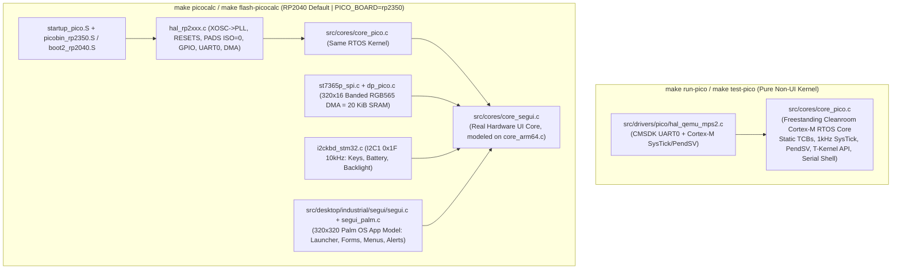

# Production PicoCalc & Raw Pico Series Port Plan — Rev 2 (`btron`)

> [!IMPORTANT]
> **Locked Requirements (Rev 2)**
> 1. **Default Board**: **RP2040 (Pico 1, Dual Cortex-M0+, 264 KiB SRAM, 2 MiB Flash)**, switchable via `PICO_BOARD=rp2350` (**Pico 2, Dual Cortex-M33, 520 KiB SRAM, 4 MiB Flash**).
> 2. **Dual Packaging for Both Chips**: `make picocalc` emits **both** standard **`.uf2`** (works for USB `BOOTSEL` **and** SD-card `uf2loader`) **and** `+200 KiB` offset **`-sdboot.bin`** (for `pico_multi_booter` / `sd_boot`) for **both RP2350 and RP2040**.
> 3. **Zero External SDK**: Pure LLVM `/opt/homebrew/opt/llvm/bin/clang` + `ld.lld` + `llvm-objcopy` + Python `scripts/tool_mk_uf2.py`. Both `thumbv8m.main-none-eabi` (RP2350) and `thumbv6m-none-eabi` (RP2040) are verified on host.

---

## 1. Direct Answers to Your Questions

### Q1: Should we support Ski / SD Bootloader in the PicoCalc build?
**Yes — and with zero extra runtime bloat.**
- **Standard `.uf2` (linked at `0x10000000`)**: Compatible out-of-the-box with **native USB `BOOTSEL`** (`/Volumes/RP2350` or `/Volumes/RPI-RP2`) **and** modern PicoCalc SD-card UF2 loaders like **`pelrun/uf2loader`** (`pico2-apps/` and `pico1-apps/`). We reserve the upper flash region (never self-erasing upper sectors) so `uf2loader` / RP2350 flash partitions remain intact.
- **`pico_multi_booter` / `sd_boot` `.bin` (linked at `0x10032000`, `+200 KiB`)**: Emitted alongside `.uf2` for **both RP2350 and RP2040** using a parameterized linker offset (`FLASH_OFFSET=0x32000`, matching `clockworkpi/PicoCalc/Code/pico_multi_booter/memmap_default_rp2350.ld` and `memmap_default_rp2040.ld`).
- **Any custom bootloader slot (if "Ski Bootloader" refers to a specific fork with a different offset)**: Because `FLASH_OFFSET` is a single linker parameter (`-Wl,--defsym=BTRON_FLASH_OFFSET=...`), supporting any alternate bootloader slot is a 1-line target without touching C code. *(If you have a specific repo/URL for Ski Bootloader, drop it in your reply and we will lock its exact header/offset into `Makefile`!)*

### Q2: Should we redesign `SegUI` with the Palm OS application model — and can we reuse `SegUI`'s coordinate-free autolayout?
**Strong YES to both — zero pixel coordinates in any app!**
`src/desktop/industrial/segui/segui.c` **already** has a coordinate-free autolayout engine (`resolve_segments()` + `resolve_body()`): applications never name a pixel coordinate. Buttons auto-flow into a responsive grid (`min_col_w`, `max_cols`, `btn_h`, `gap`), stacked `CHECK`/`TOGGLE` rows flow below the grid, and container widgets (`SEGUI_W_LIST`, `SEGUI_W_CHAT`) automatically claim the full remaining `SEG_BODY`.

By layering the **Palm OS 5 HiRes (`320 × 320`) application model** directly on top of `SegUI`'s existing autolayout:
1. **Zero Custom Draw / Zero Pixel Coordinates in Apps**: Every Palm-style app is just a coordinate-free `build(SEGUI_APP *app, const SEGUI_PROFILE *prof)` function (identical to `segui_demo_build()` and `segui_phone_build()`) plus optional `on_key` / `on_tick` hooks.
2. **One New Coordinate-Free Container Widget (`SEGUI_W_TEXT`)**: Add `SEGUI_W_TEXT` alongside `SEGUI_W_LIST` and `SEGUI_W_CHAT` in `is_container()`. `resolve_body()` automatically hands it the full `SEG_BODY` minus any top `SEGUI_W_LABEL` — powering both **B-Shell** (scrolling console + prompt) and **Memo** (editable text lines + cursor) with **0 hardcoded coordinates**.
3. **Single Foreground App + Auto-Laid-Out Home Launcher (`SysUIAppSwitch`)**:
   - **Launcher (`Home`)** is just a `SEGUI_APP` with 6–8 `SEGUI_W_BUTTON` tiles (`Shell`, `Memo`, `Calc`, `SysMon`, `Prefs`, `Demo`). `resolve_body()` automatically lays them out as a crisp 3×2 or 2×3 icon grid on `320×320`!
   - Switching apps calls `cur->on_close()`, rebuilds the single static `SEGUI_APP` via `next->build(&g_app, &segui_profile_picocalc)` (zero heap), runs `segui_layout()`, and repaints.
   - Pressing `F1` (`Home`) switches back to Launcher; pressing `F2` (`Menu`) toggles an auto-sized pull-down action list; `segui_palm_alert()` shows an auto-centered modal alert inside `L->body`.
4. **Clean-Slate Replacement (No Legacy Baggage)**: Legacy `segui_demo.c` and `segui_phone.c` (Contacts/Phone demos) are **removed and fully replaced** by the new Palm OS-like `SegUI` runtime and the frozen 6 PicoCalc apps. `segui.h` / `segui.c` are streamlined around the Palm Form/Launcher/Menu/Alert architecture with zero dead demo code, and `tools/capture_segui.c` (`make segui-screens`) is updated to capture the new 320×320 PicoCalc screen set.

---

## 2. Verified Hardware Specification (RP2040 Default + RP2350)

### 2.1 ClockworkPi PicoCalc Peripherals (Identical Pinout on Pico 2 & Pico 1)

| Subsystem | Peripheral | Exact GPIO Pins | Verified Protocol / Register Details |
| :--- | :--- | :--- | :--- |
| **320×320 IPS LCD** | Sitronix **ST7365P** on **`SPI1`** | `GP10` SCK, `GP11` TX (MOSI), `GP12` RX (MISO), `GP13` CS, `GP14` DC, `GP15` RST | 4-wire SPI Mode 0, **25 MHz** default (up to 40 MHz), `MADCTL (0x36) = 0x48` (`MX \| BGR`), `INVON (0x21)` required for IPS, `COLMOD (0x3A) = 0x55` (RGB565 16-bpp) with compile-time `0x66` (RGB666) fallback, window clipped to `0..319 × 0..319` |
| **Keyboard / PMU / Backlight** | STM32 Southbridge on **`I2C1`** | `GP6` SDA, `GP7` SCL (pull-ups enabled) | 7-bit addr **`0x1F`**, **10 kHz** bus speed (`i2ckbd.h`). Regs: `0x09` Key FIFO (write `0x09`, read 2B `uint16_t`: low byte `1`=press/`2`=hold/`3`=release, high byte key: `0xB5` Up, `0xB6` Down, `0xB4` Left, `0xB7` Right, `0x08` BS, `0x0A` Enter, `0x7E` Ctrl), `0x0B` Battery (2B), `0x05` LCD Backlight, `0x0A` Kbd Backlight, `0x0E` Power-off |
| **Debug Serial** | PL011 **`UART0`** | `GP0` TX, `GP1` RX | 115200 8N1, mirrors Palm Shell / boot log |
| **SD Card (Phase 4)** | **`SPI0`** | `GP16` MISO, `GP17` CS, `GP18` SCK, `GP19` MOSI, `GP22` CD | SPI SDHC block driver for B-System HFDS `.vol` |

### 2.2 RP2350 vs RP2040 Hardware Delta (Handled Cleanly in `pico_regs.h` + `hal_rp2xxx.c`)

| Feature | **RP2350 (`PICO_BOARD=rp2350`, Pico 2)** | **RP2040 (Default, Pico 1)** |
| :--- | :--- | :--- |
| **Clang Target** | `--target=thumbv8m.main-none-eabi -mcpu=cortex-m33 -mthumb` | `--target=thumbv6m-none-eabi -mcpu=cortex-m0plus -mthumb` |
| **QEMU Machine (`run-pico`)** | **`-M mps2-an521`** (Dual Cortex-M33 — exact ISA match) | **`-M mps2-an385`** (Cortex-M3 — ARMv6-M superset) |
| **Flash / SRAM** | 4 MiB Flash (`0x10000000`) / 512 KiB + 8 KiB Scratch (`0x20000000`) | 2 MiB Flash (`0x10000000`) / 256 KiB + 8 KiB Scratch (`0x20000000`) |
| **Standalone Boot Header** | **`PICOBIN` `IMAGE_DEF`** (`0xFFFFDED3`, item `0x42/0x01/0x1021` ARM-S, `0xAB123579`) in first 4 KiB | 256-byte **CRC32-checked `.boot2`** at `0x10000000` (modeled on `OpenPicoRTOS/arch/arm/armv6-m/mach-rp2040/boot2.S`) |
| **UF2 Family ID** | **`0xE48BFF59`** (`RP2350_ARM_S`) | **`0xE48BFF56`** (`RP2040`) |
| **SD-Boot Offset (`.bin`)** | `0x10032000` (`+200 KiB`, 3896 KiB avail) | `0x10032000` (`+200 KiB`, 1848 KiB avail) |
| **Peripheral Bases** | `CLOCKS=0x40010000`, `RESETS=0x40020000`, `IO_BANK0=0x40028000`, `PADS_BANK0=0x40038000`, `XOSC=0x40048000`, `PLL_SYS=0x40050000`, `UART0=0x40070000`, `SPI1=0x40088000`, `I2C1=0x40098000`, `TIMER0=0x400B0000` | `CLOCKS=0x40008000`, `RESETS=0x4000C000`, `IO_BANK0=0x40014000`, `PADS_BANK0=0x4001C000`, `XOSC=0x40024000`, `PLL_SYS=0x40028000`, `UART0=0x40034000`, `SPI1=0x40040000`, `I2C1=0x40048000`, `TIMER=0x40054000` |
| **Critical Silicon Bring-Up Detail** | **Must clear `PADS_BANK0_GPIOx` bit 8 (`ISO=0`)** on every configured pin (RP2350 resets pads isolated); SysClk 150 MHz (12 MHz XOSC → PLL) | No pad `ISO` bit; SysClk 125 MHz (12 MHz XOSC → PLL); `boot2` must have valid MPEG-2 CRC32 at offset `0xFC` |

---

## 3. Layered Core Architecture (`core_pico.c` + `core_segui.c`)



### Unified 20 KiB Banded RGB565 Display Pipeline (`dp_pico.c`)
- Even though RP2350 has 520 KiB SRAM, keeping a **double-buffered 320×16 RGB565 strip renderer (20 KiB total SRAM)** with **SPI1 DMA ping-pong** means:
  - **Identical rendering code** for both RP2350 and RP2040 (zero `#ifdef` divergence).
  - Leaves **~460 KiB SRAM free on RP2350** and **~200 KiB SRAM free on RP2040** for apps, buffers, and future HFDS caching.
  - Full-screen refresh at 25 MHz SPI1 ≈ **65 ms (~15 FPS)**; dirty-band / keystroke / menu updates ≈ **3–8 ms**.
  - Compile-time `PICOCALC_LCD_RGB666=1` fallback if any panel revision ever requires `COLMOD = 0x66`.

---

## 4. Coordinate-Free Palm OS UI Architecture on `SegUI` (`320 × 320`)

> [!TIP]
> **Zero Pixel Coordinates in Any Application**: Every app below delegates 100% of geometry to `SegUI`'s existing `resolve_segments()` + `resolve_body()` autolayout engine. If the display profile changes (320×320 PicoCalc, 480×272 TFT, 480×800 handset), every Palm app automatically reflows without changing a single line of app code.

### 4.1 Screen Budget (`segui_profile_picocalc`, `320 × 320` exact)
| Segment | Height | Autolayout Behavior |
| :--- | ---: | :--- |
| `SEG_STATUS` | 20 px | Left: Palm-style active app title; Right: Clock + Battery `%` + Backlight |
| `SEG_TABBAR` | 0 px (or 22 px when app has >1 Form) | Omitted for single-form apps (`n_tab == 1`), auto-shown for multi-form apps (like `Demo`) |
| `SEG_BODY` | 276 px (or 254 px w/ tabs) | `stretch = TRUE` — `resolve_body()` auto-lays out labels + button grid + stacked rows, OR a full-body container (`LIST` / `CHAT` / `TEXT`) |
| `SEG_SOFTKEY` | 24 px | `[F1 Home]  [F2 Menu]  [Enter OK]  [Esc Back]` |
| **Overlay (0 px idle)** | Dynamic | **Palm Menu** (`F2`): 1-column `SEGUI_ROW` dropdown anchored under `SEG_STATUS`, auto-sized via `segui_row_h()`. **Modal Alert**: auto-centered inside `L->body`. |

### 4.2 Palm OS Event & Lifecycle Pipeline (`segui_palm.h` / `segui_palm.c`)
Every application is a static, zero-heap descriptor — **no `on_draw` pixel code required**:
```c
typedef struct {
    const char *id;         /* e.g. "shell", "memo", "sysmon"            */
    const char *title;      /* Launcher tile label & status title        */
    SEGUI_ICON  icon;       /* Built-in SegUI vector icon                */
    void (*build)(SEGUI_APP *app, const SEGUI_PROFILE *prof); /* Widgets */
    BOOL (*on_key)(SEGUI_APP *app, int key);   /* Optional app key hook  */
    void (*on_tick)(SEGUI_APP *app, uint32_t ms); /* Optional 1Hz/10Hz   */
    void (*on_close)(SEGUI_APP *app);          /* Save state on switch   */
} SEGUI_PALM_APP;
```
**Dispatch order (classic Palm OS `AppEventLoop`)**:
1. `F1` (`Home`) → `segui_palm_switch(PALM_APP_LAUNCHER)` (calls `on_close` → `next->build(&g_app, prof)` → `segui_layout` → repaint).
2. `F2` (`Menu`) → toggles Palm dropdown menu overlay (consumes Up/Down/Enter/Esc while open).
3. Active Modal Alert → consumes Enter/Esc while open.
4. `app->on_key()` → lets text/shell apps consume typing/Enter/Backspace before generic focus navigation.
5. `segui_key(&g_app, key)` → standard `SegUI` autolayout focus/scroll/activate handling!

### 4.3 Frozen PicoCalc App Suite — 8 Apps (4×2 Launcher Grid)

Full specification: [doc/txt/PICO.txt](file:///Users/tonpa/depot/bitedits/btron/doc/txt/PICO.txt).

**Launcher (`Home`)**: 8 `SEGUI_W_BUTTON` tiles auto-gridded by `resolve_body()` into a balanced **4×2 icon grid** (`1`–`8` hotkeys + arrow keys + `Enter`).

| # | App | `SegUI` Widgets (Zero Coordinates) | Role & Footprint |
| :-: | :--- | :--- | :--- |
| **1** | **Terminal** | `SEGUI_W_TEXT` | Interactive B-System shell (`ver`, `mem`, `ps`, `ls`, `cat`, `bat`, `bkl`, `kbkl`, `lcd`, `reboot`), mirrored to `UART0`. (~6 KiB Flash, 4 KiB scrollback SRAM) |
| **2** | **Editor** | `SEGUI_W_LABEL` + `SEGUI_W_TEXT` | Lightweight B-System text/TAD scratchpad editor (cursor, insert/BS/Enter, load/save RAM/SD). (~8 KiB Flash, 8 KiB doc SRAM) |
| **3** | **Browser** | `SEGUI_W_LIST` + `SEGUI_W_TEXT` | Local TAD / Hypertext / Manual reader (browse embedded `/SYS` docs & saved files, `Enter` follow / `Esc` back). (~10 KiB Flash, 4 KiB SRAM) |
| **4** | **Cabinet** | `SEGUI_W_LIST` | B-System VObj / Volume file manager (browse RAM `/SYS` & Phase 4 SD HFDS volumes, open in Editor/Browser). (~8 KiB Flash, 4 KiB SRAM) |
| **5** | **GLGears** | `SEGUI_W_CANVAS` (320×16 RGB565 + **10 KiB banded 16-bit Z-buffer**) | 3-gear 3D Lambertian-shaded benchmark (**RP2350 FPv5-SP hardware FPU** / RP2040 Q16.16 fixed-point), live FPS & SPI1 telemetry in `SEG_STATUS`. (~10 KiB Flash, 10 KiB shared Z-band SRAM) |
| **6** | **Contacts** | `SEGUI_W_LIST` (`HEADER` + `PERSON` + `ARROW`) | Redesigned Palm-style Contacts / People directory (replaces legacy `segui_phone.c`); selecting a person switches directly to **Phone** with that peer active. (~4 KiB Flash, 1 KiB SRAM) |
| **7** | **Phone** | `SEGUI_W_CHAT` + `SEGUI_W_LIST` (2-Form: Chat & Circles/Dial) | Redesigned Palm-style Phone / LoRa Chat & People communicator (replaces legacy `segui_phone.c`), with QWERTY quick-reply input. (~5 KiB Flash, 2 KiB SRAM) |
| **8** | **Preferences** | `SEGUI_W_LIST` (`HEADER` + `VALUE` + `TOGGLE` + `ARROW`) + Modal Alert | Custom PicoCalc SegUI Preference Window: **LCD Backlight** (`0x05`), **Key Backlight** (`0x0A`), **SegUI Theme** (`Handset`/`Retro`/`Appliance`), **Battery %** (`0x0B`), **CPU/SRAM/RTOS Telemetry**, **UART0 Mirror**, **Reboot to BOOTSEL**, and **Power-Off** (`0x0E` with confirm). (~6 KiB Flash, 2 KiB SRAM) |

#### Total Frozen Resource Budget (Kernel + Drivers + SegUI + Palm Shell + All 8 Apps + 8×16 Font)
- **Flash**: **~115–135 KiB** total (`-Os --gc-sections`) — **3.3%** of RP2350 (4 MiB) and **6.6%** of RP2040 (2 MiB).
- **Static SRAM**: **~60 KiB** peak (20 KiB banded RGB565 + 10 KiB banded Z-buffer + 16 KiB RTOS/TCBs + 14 KiB app buffers) — **11.5%** of RP2350 (520 KiB) and **22.7%** of RP2040 (264 KiB). Zero post-boot `malloc`.

---

## 5. Planned File Layout

```text
src/cores/
  core_pico.c                 # Freestanding clean-room Cortex-M RTOS core (QEMU + PicoCalc base)
  core_segui.c                # Freestanding clean-room 320x320 PicoCalc Real Hardware Core (Palm/SegUI)

src/drivers/pico/
  pico_hal.h                  # Unified HAL contract (UART, timer, GPIO, SPI1, I2C1, DMA, reboot)
  pico_regs.h                 # Clean-room RP2350 (default) & RP2040 MMIO register definitions
  picobin_rp2350.S            # RP2350 PICOBIN ARM-S IMAGE_DEF block (0xFFFFDED3 .. 0xAB123579)
  boot2_rp2040.S              # RP2040 256-byte XIP stage-2 bootloader (CRC32 patched by tool_mk_uf2.py)
  startup_pico.S              # Unified Cortex-M33 / Cortex-M0+ vector table, Reset/SysTick/PendSV handlers
  hal_qemu_mps2.c             # QEMU mps2-an521 (RP2350) / mps2-an385 (RP2040) HAL
  hal_rp2xxx.c                # Real RP2350 (150 MHz + PADS ISO=0) & RP2040 (125 MHz) HAL
  st7365p_spi.c               # ST7365P 320x320 SPI1 driver (PicoCalc init, RGB565/RGB666, DMA flush)
  i2ckbd_stm32.c              # STM32 0x1F I2C1 driver (10 kHz: FIFO 0x09, Battery 0x0B, Backlight 0x05/0x0A)
  dp_pico.c                   # Banded 320x16 RGB565 GDEV (fill_rec, drw_str, 8x16 Flash font)
  link_pico_qemu.ld           # QEMU mps2-an521 / mps2-an385 linker script
  link_picocalc.ld            # Parameterized RP2350/RP2040 linker script (UF2 @ 0x10000000 & SD-Boot @ +200 KiB)

src/desktop/industrial/segui/
  segui.c / include/btron/segui.h       # Streamlined coordinate-free SegUI core (320x320 PicoCalc + TEXT/CANVAS)
  segui_palm.c / include/btron/segui_palm.h  # Palm OS App Launcher, Form/Menu/Alert dispatch, 6 frozen apps
  (REMOVED: legacy segui_demo.c, segui_phone.c — fully replaced by Palm/SegUI suite)

scripts/
  tool_mk_uf2.py              # Zero-dep Python UF2 generator (RP2350 0xE48BFF59 + RP2040 0xE48BFF56 + boot2 CRC32)
  test_pico.sh                # Headless QEMU CI test for both RP2350 (mps2-an521) & RP2040 (mps2-an385)
  test_picocalc_build.sh      # Verifies both RP2350 & RP2040 UF2 + SD-boot .bin, PICOBIN/boot2 CRC32, SRAM budget, 320x320 SegUI
```

---

## 6. Makefile Targets

| Command | Default (`PICO_BOARD=rp2040`) | With `PICO_BOARD=rp2350` |
| :--- | :--- | :--- |
| `make pico` | `.build/pico-qemu-rp2040/btron-pico-rp2040-qemu.elf` (Cortex-M0+) | `.build/pico-qemu-rp2350/btron-pico-rp2350-qemu.elf` (Cortex-M33) |
| `make run-pico` | `qemu-system-arm -M mps2-an385 -nographic -serial stdio` | `qemu-system-arm -M mps2-an521 -nographic -serial stdio` |
| `make test-pico` | Runs `scripts/test_pico.sh` on **both** `mps2-an385` & `mps2-an521` | Same |
| `make picocalc` | Emits `btron-picocalc-rp2040.uf2` **+** `btron-picocalc-rp2040-sdboot.bin` (and symlinks `btron-picocalc.uf2`) | Emits `btron-picocalc-rp2350.uf2` **+** `btron-picocalc-rp2350-sdboot.bin` |
| `make picocalc-all` | Builds **all 4 real-hardware artifacts** (RP2040 UF2 + SD-bin, RP2350 UF2 + SD-bin) | Same |
| `make flash-picocalc` | Builds the RP2040 UF2. Volume detection still accepts `/Volumes/RPI-RP2` or `/Volumes/RP2350` | Builds the RP2350 UF2. Volume detection is the same |
| `make test-picocalc` | Builds both images on both boards and rejects `ztriangle`, `e1m1`, and `progs.dat` | Same |

---

## 7. Battery & Power-Efficiency Architecture + Spec-Driven Discipline

1. **Minimal, Spec-Driven Clean Code**:
   - Compiled with `-Os -ffunction-sections -fdata-sections -Wl,--gc-sections -Wall -Wextra -Werror` on all new Pico/SegUI sources; NASA JPL Rule 3 compliant (zero post-boot `malloc`, bounded loops, static buffers).
   - Every register address, bitfield, and init command cites its primary spec (RP2350 DS, RP2040 DS, ST7365P V1.0, STM32 `i2ckbd`, ARMv8-M/v6-M ARM).
2. **Battery Optimization (18650 Handheld Discipline)**:
   - **Zero Busy-Wait (`WFI` Idle + Core 1 Parked)**: Idle task executes `wfi`; Core 1 remains parked in bootrom/deep `wfe` (~30–40% core dynamic power savings).
   - **0 FPS Static Rendering (20-Bit `dirty_bands` Mask)**: Zero SPI1 clocks and zero DMA bursts when screen is static; only **GLGears** ticks continuously (pauses on `Space`/idle).
   - **Smart Backlight & ST7365P Sleep**: Keyboard backlight (`0x0A`) defaults **OFF** at boot; inactivity dims LCD (`0x05`) at 60 s and enters `DISPOFF (0x28)` + `SLPIN (0x10)` at 5 min (instant wake on any key).
   - **Adaptive I2C1 Polling**: Key FIFO (`0x09`) polled at 50 Hz while active → steps down to 10 Hz after 3 s idle; Battery (`0x0B`) polled every 15 s.
   - **Unused Peripheral Gating**: Keep ADC, PWM, PIO, SPI0 (when SD idle), I2C0, UART1, USBCTRL, HSTX, TRNG held in `RESETS`.

---

## 8. Gap Analysis & Silicon Bring-Up Safeguards

| # | Real-Hardware Risk | Mitigation Built into Plan |
| :-: | :--- | :--- |
| **G1** | **RP2350 `TICKS` Block (`0x40108000`)** — `TIMER0` & `PROC0` SysTick ref stay frozen at 0 if `TICKS` is not enabled | `hal_rp2xxx.c` programs `TICKS_TIMER0_CYCLES=12`, `TICKS_TIMER0_CTRL=1` (1 MHz) and `TICKS_PROC0_CTRL=1` before enabling SysTick |
| **G2** | **RP2350 Pad Isolation (`PADS_BANK0` bit 8 `ISO=1`)** — GPIO outputs stay dead after reset | `hal_rp2xxx.c` clears `ISO=0` on every configured GPIO (`GP0/1`, `GP6/7`, `GP10-15`) |
| **G3** | **I2C1 Stuck-Low `SDA`** — MCU reset mid-transaction can leave STM32 holding `GP6` LOW | `i2ckbd_init()` checks `GP6`; if LOW, bit-bangs 9 `SCL` pulses (`GP7`) + STOP before enabling `I2C1` |
| **G4** | **Silent Crash on Blank Screen** | `HardFault_Handler` dumps `PC/LR/PSR/CFSR/HFSR` to `UART0` + paints a blocking raw-SPI1 red panic banner on ST7365P |
| **G5** | **SD-Boot (`+200 KiB`) Dirty State** — `pico_multi_booter` may leave IRQs/DMA active | `Reset_Handler` starts with `cpsid i`, explicitly sets `SCB->VTOR = __vectors_start__`, and resets `SPI1`/`I2C1`/`DMA` |
| **G6** | **Legacy Removal Blast Radius** — deleting `segui_demo.c` / `segui_phone.c` | Verified via repo-wide grep: only `Makefile` (`CAPTURE_SEGUI_SRCS`), `include/btron/segui.h`, `tools/capture_segui.c`, and `scripts/screen_update_segui.py` reference them — updated atomically in Phase 2 |

---

## 9. Phased Delivery & Verification Gates

1. **Phase 1 — Raw Pico Series QEMU Kernel (`make pico`, `make run-pico`, `make test-pico`)**:
   - `startup_pico.S` (ARMv8-M + ARMv6-M), `hal_qemu_mps2.c`, `core_pico.c` (1 kHz SysTick, PendSV preemptive context switch, static T-Kernel tasks/semaphores/eventflags, `btron-pico#` shell), `scripts/test_pico.sh`.
   - **Gate**: `make test-pico` passes on **both** `mps2-an521` (RP2350) and `mps2-an385` (RP2040) with 0 warnings.
2. **Phase 2 — 320×320 Palm-Style `SegUI` & Host Pixel Verification**:
   - `segui_profile_picocalc` + `segui_palm.c` (Launcher, B-Shell, SysMon, Memo, Prefs, Menu overlay, Modal Alert) + 320×320 capture in `tools/capture_segui.c`.
   - **Gate**: `make segui-screens` captures verified 320×320 Palm/SegUI screens with 0 px overflow.
3. **Phase 3 — RP2350 (Default) & RP2040 Real Hardware Drivers, `core_segui.c`, UF2 & SD-Boot (`make picocalc`, `make flash-picocalc`, `make test-picocalc`)**:
   - `pico_regs.h`, `picobin_rp2350.S`, `boot2_rp2040.S`, `hal_rp2xxx.c` (with RP2350 `PADS ISO=0` + 150 MHz PLL and RP2040 125 MHz PLL), `st7365p_spi.c`, `i2ckbd_stm32.c`, `dp_pico.c`, `core_segui.c`, `scripts/tool_mk_uf2.py`, `scripts/test_picocalc_build.sh`.
   - **Gate**: `make picocalc-all && make test-picocalc` passes every static/binary/UF2/SD-boot/CRC32/PICOBIN/SRAM gate and is ready for immediate `make flash-picocalc`.
4. **Phase 4 — Hardware Bring-Up & Optional SD HFDS**:
   - First-boot hardware checklist (UART0 log → ST7365P color bar → Palm Launcher → I2C1 keys/battery/backlight), followed by optional SPI0 SD card HFDS mount.

