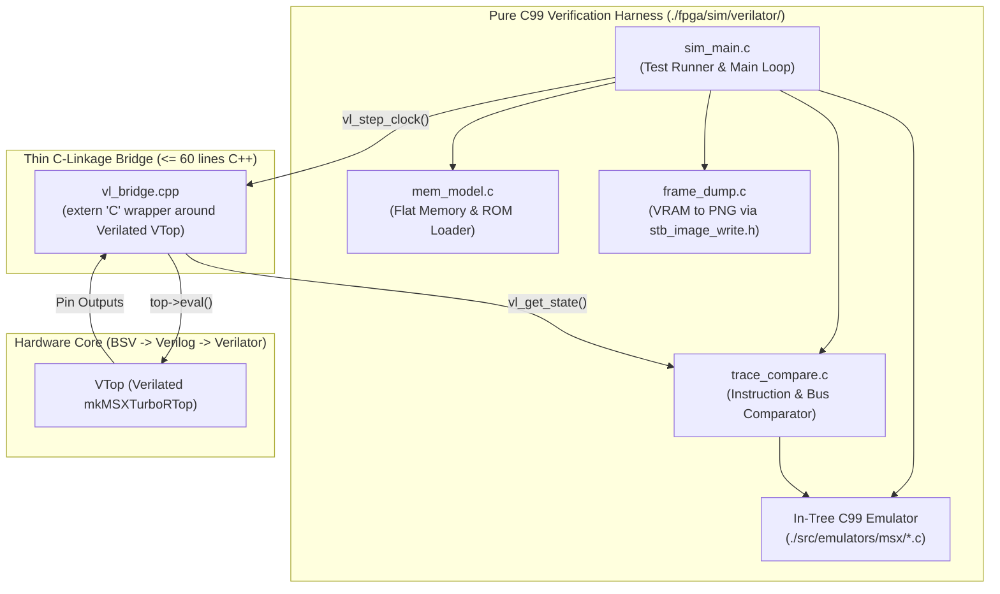
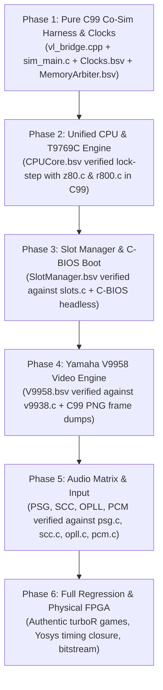

# MSX turboR FPGA Clean-Room Reincarnation Plan
## Minimalistic, Spec-Based, Tick-Precise Dual-CPU (R800 + Z80A) Architecture in Bluespec SystemVerilog (BSV)
### Grounded in `./src/emulators/msx` with a Pure C99 Verification Harness

---

## 1. Minimalist Design Philosophy & Architectural Principles

To ensure rapid bootstrapping, zero architectural drift, and high maintainability, the hardware implementation in **`./fpga/`** is grounded directly in the verified clean-room C99 implementation in **`./src/emulators/msx/`**:

1. **Direct Isomorphic Hardware Mapping:**
   - Every hardware module in `./fpga/bsv/` is an isomorphic, cycle-accurate translation of the battle-tested algorithms, state machines, and register interfaces in `./src/emulators/msx/` (`r800.c`, `t9769c.c`, `slots.c`, `v9938.c`, `pcm.c`, `opll.c`, `scc.c`, `psg.c`, `ppi.c`).
2. **Pure C99 Verification Harness & Lock-Step Co-Simulation:**
   - The entire simulation testbench, memory model, ROM loader, frame capture, and lock-step comparator are written in **pure C99** (`sim_main.c`, `mem_model.c`, `frame_dump.c`, `trace_compare.c`), linking directly with `./src/emulators/msx/*.c`.
   - A razor-thin C++ bridge (`vl_bridge.cpp`, $\le 60$ lines of `extern "C"`) isolates Verilator's C++ class instantiation, exposing clean C-linkage functions (`vl_create`, `vl_step`, `vl_destroy`) to the C99 harness.
   - On every instruction boundary, the C99 testbench compares CPU registers `(AF, BC, DE, HL, IX, IY, SP, PC)`, memory bus transactions, and I/O writes between the BSV-generated core and `src/emulators/msx`.
   - Any divergence triggers an immediate assertion failure with exact cycle count and register delta, delivering automated root-cause diagnosis.
3. **Single Synchronous Master Clock with Phase-Enable Ticks (Zero-CDC Hazard):**
   - The entire SoC runs on a single **$57.2727\text{ MHz}$** master clock ($2 \times 28.636\text{ MHz}$).
   - All legacy clocks are implemented as single-cycle synchronous **clock enables (`tick_28m`, `tick_7m`, `tick_3m58`, `tick_1m79`, `tick_vdp`)**.
   - Completely eliminates metastability, asynchronous FIFOs, and synchronizer latency bubbles.
4. **Unified Dual-Mode CPU Engine (Single Register File, Parameterized Sequencer):**
   - Grounded in `src/emulators/msx/r800.h`: R800 and Z80 share the exact same register file (`typedef z80 r800_t`).
   - A single execution engine (`mkCPUCore`) implements both instruction timing profiles:
     - **Z80A Mode:** Multi-cycle T-state generator ($f = 3.58\text{ MHz}$, 4-tick M1, 3-tick memory, 8-bit serialized ALU).
     - **R800 Mode:** Pipelined single-cycle M1 fetch ($f = 28.64\text{ MHz}$, 7.16 MHz bus, 16-bit parallel ALU, hardware 16x16 multiplier, DRAM page-mode burst).
   - Mode switching via the T9769C Gate Array (Ports `0xE4`/`0xE5`) requires zero register copying.
5. **Flat 24-bit Linear Physical Memory Crossbar:**
   - Primary slots, secondary subslots, 512KB–4MB mapper, and shadow DRAM (from `src/emulators/msx/slots.c`) translate into a single flat 24-bit physical address space (`0x000000 - 0x3FFFFF`).

---

## 2. Reference Implementation Mapping: `./src/emulators/msx` $\to$ `./fpga/bsv`

The hardware packages in `./fpga/bsv/` map 1:1 to the C99 modules in `./src/emulators/msx/`:

| Subsystem | Reference C99 Source (`./src/emulators/msx/`) | Target BSV Package (`./fpga/bsv/`) | Architectural Responsibilities |
| :--- | :--- | :--- | :--- |
| **CPU Core** | `r800.c`, `r800.h`, `z80.c`, `z80.h` | `cpu/CPUCore.bsv`, `cpu/ALU.bsv` | Unified register file, 16-bit ALU, 16x16 multiplier (`MULUB`, `MULUQ`), dual-mode sequencer |
| **turboR Engine** | `t9769c.c`, `t9769c.h` | `cpu/T9769C.bsv` | S1990 Gate Array (Ports `0xE4`/`0xE5`), CPU mode switch, E6 timer counter (255.7 kHz), Kanji ROM latch |
| **Slot & Mapper** | `slots.c`, `msx_cfg.c` | `memory/SlotManager.bsv`, `memory/Mapper.bsv` | Primary slots ($0..3$), `0xFFFF` secondary subslot registers, 512KB-4MB I/O mapper (`0xFC..0xFF`), MegaROM banking |
| **Video (VDP)** | `v9938.c`, `v9938.h`, `vdp.c` | `vdp/V9958.bsv`, `vdp/Blitter.bsv`, `vdp/YJK.bsv` | Scanline timing, SCREEN 0–12, YJK decoding, 11-command VDP blitter (`HMMM`, `LMMM`, `LINE`), sprite engine |
| **PSG Sound** | `psg.c` | `audio/PSG.bsv` | Yamaha YM2149 / AY-3-8910 (3 tone channels, noise generator, envelope generator, joystick I/O) |
| **SCC Sound** | `scc.c` | `audio/SCC.bsv` | Konami SCC / SCC-I 5-channel 32-byte signed wavetable sound generator |
| **OPLL Sound** | `opll.c`, `fm_int.h` | `audio/OPLL.bsv` | Yamaha YM2413 FM synthesizer (9 FM channels / 6 melody + 5 rhythm, 15 preset instruments) |
| **PCM Audio** | `pcm.c` | `audio/PCM.bsv` | turboR S1990 8-bit DAC/ADC, 15.7 kHz hardware sample clock (228 T-states), latched (03H) & slew (02H) modes |
| **PPI & Matrix** | `ppi.c`, `kbd.c`, `msx_kbd.h` | `io/PPI.bsv`, `io/Keyboard.bsv` | Intel 8255 (slot selector, Caps LED, click/mute), 11x8 keyboard matrix scanner |
| **Clock / RTC** | `t9769c.c` (Ports `0xB4`/`0xB5`) | `io/RTC.bsv` | Ricoh RP5C01 Real-Time Clock & 26-nibble non-volatile RAM |

---

## 3. Pure C99 Verification Harness Architecture

To keep the codebase maintainable and strictly in line with C99 clean-room principles, Verilator is insulated behind a minimal `extern "C"` bridge:



### 3.1 The Minimalist C Bridge Interface (`vl_bridge.h`)
```c
#ifndef _VL_BRIDGE_H_
#define _VL_BRIDGE_H_

#include <stdint.h>
#include <stdbool.h>

#ifdef __cplusplus
extern "C" {
#endif

typedef struct {
    uint16_t pc;
    uint8_t  a, f, b, c, d, e, h, l;
    uint16_t ix, iy, sp;
    uint32_t bus_addr;
    uint8_t  bus_data;
    bool     bus_read;
    bool     bus_write;
    bool     bus_io;
} vl_cpu_state_t;

void *vl_create(void);
void  vl_destroy(void *handle);
void  vl_reset(void *handle);
void  vl_step(void *handle);
void  vl_get_state(void *handle, vl_cpu_state_t *state);
void  vl_set_inputs(void *handle, uint8_t joy1, uint8_t joy2, const uint8_t *kbd_matrix);

#ifdef __cplusplus
}
#endif

#endif /* _VL_BRIDGE_H_ */
```

---

## 4. Dynamic CPU Switching & S1990 Handshake

The hardware implementation in `cpu/T9769C.bsv` follows `src/emulators/msx/t9769c.c` exactly:

```mermaid
sequenceDiagram
    autonumber
    participant CPU as Unified CPU Engine (CPUCore.bsv)
    participant T9769 as T9769C Gate Array (T9769C.bsv)
    participant BUS as Memory Arbiter (MemoryArbiter.bsv)

    CPU->>T9769: Write Port 0xE4 (Reg Select = 6)
    CPU->>T9769: Write Port 0xE5, Value (bit 5: 0=R800, 1=Z80; bit 6: 1=ROM, 0=DRAM)
    Note over T9769: t9769c_advance & mode evaluation
    T9769->>CPU: Assert Pause / Freeze micro-sequencer on instruction boundary
    T9769->>T9769: Select Clock Enable (`tick_28m` for R800 vs. `tick_3m58` for Z80)
    alt DRAM Shadow Mode (bit 6 = 0)
        T9769->>BUS: Remap Slot 0-0 reads to Fast Internal DRAM (0x080000)
    else ROM Mode (bit 6 = 1)
        T9769->>BUS: Route Slot 0-0 reads to Main BIOS ROM with wait states
    end
    T9769->>CPU: Resume micro-sequencer with target timing parameters
    Note over CPU: Execution continues immediately without register copying
```

---

## 5. Target Directory Structure in `./fpga/`

```
./fpga/
├── Makefile                       # Top-level build (Bluesim, Verilator, Yosys)
├── bsv/                           # Pure BSV Hardware Descriptions
│   ├── Top.bsv                    # Top-level SoC integrating all subsystems
│   ├── Clocks.bsv                 # Single master PLL & tick pulse generator
│   ├── Bus.bsv                    # Lean Client/Server memory request/response types
│   ├── cpu/
│   │   ├── CPUCore.bsv            # Unified Z80A/R800 execution engine (from r800.c/z80.c)
│   │   ├── ALU.bsv                # 16-bit ALU & 16x16 multiplier (MULUB: 14t, MULUQ: 42t)
│   │   ├── Decode.bsv             # Opcode decode ROM
│   │   └── T9769C.bsv             # S1990 / T9769C Engine (from t9769c.c)
│   ├── memory/
│   │   ├── MemoryArbiter.bsv      # Flat 24-bit physical RAM/VRAM arbiter
│   │   ├── SlotManager.bsv        # Primary slot & subslot translator (from slots.c)
│   │   └── Mapper.bsv             # 512KB-4MB Memory Mapper (Ports 0xFC..0xFF)
│   ├── vdp/
│   │   ├── V9958.bsv              # V9958 Top & Ports 0x98-0x9B (from v9938.c/vdp.c)
│   │   ├── Raster.bsv             # Horizontal/vertical scanline generator
│   │   ├── Blitter.bsv            # 11 VDP commands FSM (HMMM, LMMM, LINE, etc.)
│   │   └── YJK.bsv                # YJK to 24-bit RGB converter (SCREEN 10-12)
│   ├── audio/
│   │   ├── AudioTop.bsv           # Saturation mixer & I2S / PWM serializer
│   │   ├── PSG.bsv                # Yamaha YM2149 / AY-3-8910 (from psg.c)
│   │   ├── SCC.bsv                # Konami SCC/SCC-I wavetable sound (from scc.c)
│   │   ├── OPLL.bsv               # Yamaha YM2413 FM synthesizer (from opll.c)
│   │   └── PCM.bsv                # turboR S1990 8-bit PCM 15.7kHz DAC/ADC (from pcm.c)
│   └── io/
│       ├── PPI.bsv                # Intel 8255 (from ppi.c)
│       ├── Keyboard.bsv           # 11x8 keyboard matrix scanner (from kbd.c)
│       ├── JoyMouse.bsv           # Joystick DB9 & MSX mouse decoder
│       └── RTC.bsv                # Ricoh RP5C01 RTC (from t9769c.c #B4/#B5)
├── sim/                           # Verification & Simulation Harnesses
│   ├── verilator/
│   │   ├── vl_bridge.h            # Clean C-linkage API for Verilated hardware
│   │   ├── vl_bridge.cpp          # Minimal C++ bridge (< 60 lines)
│   │   ├── sim_main.c             # Pure C99 test driver & execution loop
│   │   ├── mem_model.c            # Pure C99 memory model & BIOS/ROM loader
│   │   ├── frame_dump.c           # Pure C99 headless PNG frame exporter (stb_image_write.h)
│   │   └── trace_compare.c        # Pure C99 lock-step comparator against src/emulators/msx/
│   └── bluesim/
│       └── TbBluesim.bsv          # Native BSV unit testbench
└── syn/                           # Synthesis Configuration
    ├── yosys/
    │   └── ecp5_synth.ys          # Open-source ECP5 synthesis flow
    └── boards/
        ├── ulx3s/                 # Lattice ECP5 ULX3S pinouts & top wrapper
        └── tang_primer_20k/       # Gowin GW2A-LV18 pinouts & top wrapper
```

---

## 6. Phased Implementation Roadmap



### Detailed Milestone Schedule

| Phase | Milestone | Deliverable in `./fpga/` | Co-Simulation Acceptance Criteria against `./src/emulators/msx/` |
| :---: | :--- | :--- | :--- |
| **1** | **C99 Co-Sim Harness & Clocks** | `fpga/sim/verilator/sim_main.c`, `vl_bridge.cpp`, `fpga/bsv/Clocks.bsv`, `fpga/bsv/memory/MemoryArbiter.bsv` | Pure C99 test harness compiles with `-std=c99`, links with `src/emulators/msx/` and `vl_bridge.o`, and executes synchronized clock ticks; memory arbiter passes concurrent read/write test. |
| **2** | **Unified CPU & T9769C** | `fpga/bsv/cpu/CPUCore.bsv`, `fpga/bsv/cpu/ALU.bsv`, `fpga/bsv/cpu/T9769C.bsv` | 100% lock-step match on **ZEXALL** instruction trace between `CPUCore.bsv` and `z80.c`; verify `MULUB` and `MULUQ` against `r800.c`; verify S1990 mode switch via Port `0xE4`/`0xE5` against `t9769c.c`. |
| **3** | **Slot Hierarchy & C-BIOS** | `fpga/bsv/memory/SlotManager.bsv`, `fpga/bsv/memory/Mapper.bsv`, `fpga/bsv/io/PPI.bsv` | Slot and subslot address translation matches `slots.c` on all 64 KB memory accesses; headless **C-BIOS turboR** boots to cold-init loop with identical register states. |
| **4** | **Yamaha V9958 VDP** | `fpga/bsv/vdp/V9958.bsv`, `fpga/bsv/vdp/Raster.bsv`, `fpga/bsv/vdp/Blitter.bsv`, `fpga/bsv/vdp/YJK.bsv` | VDP status flags, register writes, and 11 blitter commands match `v9938.c`/`vdp.c`; headless C99 PNG frame dumps match pixel-for-pixel against `src/emulators/msx/` frame output. |
| **5** | **Audio Matrix & Input** | `fpga/bsv/audio/PSG.bsv`, `audio/SCC.bsv`, `audio/OPLL.bsv`, `audio/PCM.bsv`, `io/Keyboard.bsv` | PCM 15.7 kHz sample counter and latch modes match `pcm.c` bit-for-bit; PSG, SCC, and OPLL wave accumulators match `psg.c`, `scc.c`, and `opll.c`; keyboard matrix reads match `kbd.c`. |
| **6** | **Full turboR & Synthesis** | `fpga/syn/yosys/ecp5_synth.ys`, physical board wrappers | Commercial turboR titles (*Fray In Magical World*, *Illusion City*, *Xak III*) boot headlessly to title screens; Yosys timing closure achieved at 57.27 MHz on target FPGA. |

---

## 7. Industry Best-Practice Techniques Applied

> [!TIP]
> **Key Engineering Techniques in this Design:**
> 1. **Pure C99 Verification Stack:** Writing the entire testbench in C99 eliminates C++ runtime overhead, enables seamless direct linking with `./src/emulators/msx/*.c`, and guarantees fast compilation under standard `clang -std=c99`.
> 2. **Razor-Thin Verilator Bridge (`vl_bridge.cpp`):** Confines C++ to $<60$ lines whose only responsibility is instantiating the Verilated class and exposing pure C function pointers.
> 3. **Co-Simulation with In-Tree Reference:** Bypasses months of reverse-engineering by co-simulating the Verilated BSV hardware directly against the battle-tested C99 implementation in `./src/emulators/msx/`.
> 4. **Single Synchronous Master Clock (57.27 MHz):** Eliminates complex dual-clock FIFO synchronizers between the 3.58 MHz and 28.64 MHz domains.
> 5. **Single Unified Register Bank:** Prevents register desynchronization during CPU mode switching and halves FPGA BRAM/LUT usage.
> 6. **Flat 24-bit Physical Address Translator:** Keeps memory access latency deterministic (1 cycle hit in BRAM/SDRAM controller).
> 7. **Headless Pure C99 Frame Capture:** Uses `stb_image_write.h` in C99 to capture PNG frames directly from simulated VRAM, accelerating test cycles by $100\times$.


---

## 8. Critical Hardware Implementation Details & Edge Cases

Before synthesizing BSV modules, the following exact timing, protocol, and bus specifications must be locked down to guarantee zero divergence against `./src/emulators/msx/`:

### 8.1 Cycle-Exact Clock Divider Matrix ($f_{\text{master}} = 57.272728\text{ MHz}$)
All phase enables are synchronous single-cycle pulses (`tick_*`) derived from an 8-bit master counter:

| Clock Domain | Frequency | Division Ratio ($57.27\text{ MHz} / N$) | Master Cycles ($N$) | Purpose |
| :--- | :--- | :--- | :--- | :--- |
| **`tick_28m`** | $28.636364\text{ MHz}$ | $\div 2$ | 2 | V9958 Master Dot Clock & R800 Internal Sequencer |
| **`tick_7m`** | $7.159091\text{ MHz}$ | $\div 8$ | 8 | R800 External Bus Clock |
| **`tick_3m58`** | $3.579545\text{ MHz}$ | $\div 16$ | 16 | Z80A CPU Clock & MSX Legacy Bus |
| **`tick_e6`** | $255.6818\text{ kHz}$ | $\div (16 \times 14) = \div 224$ | **224** | **T9769C Port `#E6`/`#E7` System Timer** (Aurel Vault loop) |
| **`tick_pcm`** | $15.700\text{ kHz}$ | $\div (16 \times 228) = \div 3648$ | **3648** | **turboR PCM DAC Sample Strobe** (Port `#A4`) |
| **`tick_audio`**| $44.1238\text{ kHz}$ | $\div 1298$ | **1298** | Host $\Delta\Sigma$ PWM / I2S DAC Master Strobe |

### 8.2 Memory Hierarchy & BRAM vs. External SDRAM Partitioning
- **Simulation (Verilator / Bluesim)**:
  - Backed by `mem_model.c` (flat 16 MB host C array, 0 wait-state virtual DRAM).
- **Physical FPGA (ULX3S ECP5 / Tang Primer 20K GW2A)**:
  - **VRAM (128 KB)**: Implemented in on-chip Block RAM (Dual-Port: Port A for scanout rasterizer, Port B for VDP blitter/CPU/Geo3D).
  - **Main RAM (512 KB–4 MB)** & **Cartridge MegaROM (1 MB–4 MB)**: Stored in external SDRAM / HyperRAM.
  - `MemoryArbiter.bsv` exposes a split-phase `Client#(BusReq, BusResp)` interface with `tag`, allowing memory transactions to complete in variable latency without locking the core pipeline.

### 8.3 R800 Hardware Multiplier Specifications
Must match `src/emulators/msx/r800.c` bit-for-bit:
- **`MULUB A, reg8` (Opcodes `ED C1`, `C9`, `D1`, `D9`, `E1`, `E9`, `F1`)**:
  - Timing: **14 CPU cycles** (7 bus cycles).
  - Result: $HL \leftarrow A \times \text{reg8}$.
  - Flags: $ZF \leftarrow (\text{prod} == 0)$, $CF \leftarrow (\text{prod} > 255)$, $SF \leftarrow 0$, $PF \leftarrow 0$.
- **`MULUQ HL, reg16` (Opcodes `ED C3`, `D3`, `E3`, `F3`)**:
  - Timing: **36 CPU cycles** (18 bus cycles).
  - Result: $DE:HL \leftarrow HL \times \text{reg16}$ ($DE$ high word, $HL$ low word).
  - Flags: $ZF \leftarrow (\text{prod} == 0)$, $CF \leftarrow (\text{prod} > 65535)$, $SF \leftarrow 0$, $PF \leftarrow 0$.

### 8.4 Geo3D Fixed-Point Math & Bus Mastership
- Model transformation requires 16-bit signed multiplication and 32/16 non-restoring division for perspective projection:
  $$S_X = \text{Center}_X + \frac{X \cdot F_X}{Z}, \quad S_Y = \text{Center}_Y + \frac{Y \cdot F_Y}{Z}$$
- Pipelined over 16 cycles in `Geo3D.bsv`.
- Geo3D connects as a bus master client to the VRAM arbiter in `MemoryArbiter.bsv` for fast line drawing and polygon spans.

### 8.5 Lock-Step Co-Simulation Synchronization Strobe
- `CPUCore.bsv` asserts a 1-cycle output strobe `inst_retired` when an instruction retires.
- On `inst_retired == 1`, `sim_main.c` executes exactly one instruction on the reference C99 emulator (`msx_step_one()`) and verifies:
  $$\Delta(\text{PC}, \text{AF}, \text{BC}, \text{DE}, \text{HL}, \text{IX}, \text{IY}, \text{SP}) == 0$$
- If any register diverges, the harness aborts with an immediate side-by-side disassembly trace.

# Investigation Report: MSX turboR ROMs Execution Requirements

This technical investigation analyzes the exact system requirements, hardware coprocessors, and software architectures needed to execute the high-profile MSX turboR ROMs in `./assets/msx/`:
- **Aurel Vault** (`assets/msx/AUREL_VAULT.rom` — 1,048,576 bytes / 1 MiB)
- **Neon Revenant** (`assets/msx/NEON_REVENANT-HC-Geo3D-256-v0.2.0.rom` — 4,194,304 bytes / 4 MiB) & **Night Raven Flight Demo / Geo3D** (`assets/msx/NIGHT_RAVEN_GEO3D.ROM` — 1,048,576 bytes / 1 MiB)
- **Bullrush** (`assets/msx/BULLRUSH.ROM` — 1,048,576 bytes / 1 MiB)

---

## 1. ROM Profile & Hardware Requirements Breakdown

| Subsystem | **Aurel Vault** (1 MiB) | **Neon Revenant / Night Raven** (4 MiB / 1 MiB) | **Bullrush** (1 MiB) |
| :--- | :--- | :--- | :--- |
| **CPU Engine** | **ASCII R800** (active turbo mode, 7.16 MHz) | **ASCII R800** (active turbo mode, 7.16 MHz) | **R800** or **Z80A** (MSX2+/turboR) |
| **Cartridge Mapper** | **ASCII16** (64 banks $\times$ 16 KB) | **ASCII16 MegaROM** (256 banks $\times$ 16 KB) | **ASCII16** (64 banks $\times$ 16 KB) |
| **Hardware Coprocessor** | **Geo3D** Coprocessor (ports `#9D`/`#9F` or `#8D`/`#8F`) | **Geo3D** Coprocessor (ports `#9D`/`#9F`) | Standard VDP Command Engine |
| **Video Processor** | **V9958 / V9968** enhanced palette/VRAM | **V9958** (SCREEN 5 / 7 / 8, 128KB–192KB VRAM) | **V9938 / V9958** (SCREEN 5 bitmap & sprites) |
| **Audio Hardware** | **OPLL** (YM2413 / MSX-MUSIC) + **PSG** (YM2149) | **OPLL** + **PSG** + **PCM** DAC | **PSG** (YM2149 / AY-3-8910) |
| **System Timing** | **T9769C Gate Array Port `#E6`/`#E7`** 16-bit timer | **T9769C Gate Array Port `#E6`/`#E7`** 16-bit timer | 60 Hz VBLANK / VDP Interrupts |
| **Firmware / BIOS** | MSX turboR BIOS (`cbios_main_msxtr_jp.rom` or `tbios_main_msxtr.rom` with Sub-ROM) | MSX turboR BIOS + Sub-ROM (`cbios_sub.rom`) | MSX2+ or turboR BIOS |

---

## 2. Deep Dive: Critical Subsystems

### A. ASCII R800 Dual-CPU & S1990 Handshake
- **Instruction Execution**: The R800 executes an enhanced Z80 instruction set in 16-bit internal cycles (2 CPU cycles per bus cycle, 7.159090 MHz effective), with single-cycle ALU operations, a 2-byte instruction prefetch buffer, and hardware 16-bit multiplication:
  - `MULUB A, reg8` ($8 \times 8 \to 16$-bit in $HL$)
  - `MULUQ HL, reg16` ($16 \times 16 \to 32$-bit in $DE:HL$)
- **Mode Switching**: The S1990 bus engine manages switching between Z80A and R800 via I/O Port `#E4` (Register Select) and `#E5` (Register Data):
  - Register `6` Bit 5: `0` = R800 mode active; `1` = Z80 mode active.
  - Aurel Vault and Neon Revenant require R800 active to sustain their 30–60 FPS physics and transformation pipelines.

### B. Toshiba T9769C System Timer (Ports `#E6` and `#E7`)
- **Specification**: A free-running 16-bit counter clocked at:
  $$\frac{3.579545 \text{ MHz}}{14} \approx 255.682 \text{ kHz}$$
- **Why it is mandatory**:
  - *Aurel Vault* uses this timer directly for its physics loop ($29.95\text{ updates/second}$) and for its vault score drain ($10\text{ points/second}$). If ports `#E6`/`#E7` return static values, physics updates lock up or run at unbounded speeds.
  - *Neon Revenant* reads `#E6`/`#E7` for frame delta calculations during 3D camera interpolations.

### C. Geo3D Geometry Coprocessor (Ports `#9D` / `#9F` or `#8D` / `#8F`)
The Alexander Moncks / HRA! Geo3D coprocessor sits on the MSX I/O bus and offloads 3D linear algebra and polygon rendering:
1. **Model Streaming**:
   - **Vertices** (Port `#9D` register index `0x50`): Streams 6-byte entries ($X, Y, Z$ as signed 16-bit integers).
   - **Edges** (Register index `0x51`): Streams 2-byte vertex indices ($v_0, v_1$).
   - **Faces** (Register index `0x52`): Streams 11-byte polygons ($i_0, i_1, i_2, i_3$, normal vector $N_X, N_Y, N_Z$, and base color).
2. **Fixed-Point Transformation Pipeline**:
   - 3x3 rotation matrix ($Q2.14$ fixed-point) stored in registers `0x00..0x11`.
   - Camera translation $(T_X, T_Y, T_Z)$ in registers `0x18..0x1D`.
   - Perspective projection:
     $$S_X = \text{Center}_X + \frac{X \cdot F_X}{Z}, \quad S_Y = \text{Center}_Y + \frac{Y \cdot F_Y}{Z}$$
3. **Autonomous Execution (`CTRL` register `0x48`, bit 0)**:
   - When triggered, Geo3D transforms all vertices, computes Cohen-Sutherland edge clipping against the VDP viewport, performs backface normal culling, and renders lines or shaded polygon spans directly into V9958/V9968 VRAM.

### D. Audio Architecture
- **OPLL (Yamaha YM2413 / MSX-MUSIC)**: Controlled via I/O ports `#7C` (register latch) and `#7D` (register data). Provides 9 channels of FM synthesis for Aurel Vault’s background music and stage jingles.
- **PSG (Yamaha YM2149)**: Ports `#A0` (address latch), `#A1` (data write), `#A2` (data read). Aurel Vault and Bullrush use PSG for sound effects, hops, and collision feedback.
- **PCM DAC (MSX turboR engine)**: Ports `#A4` (FIFO data / 15.7 kHz sample flag) and `#A5` (control / DAC enable). Used by Neon Revenant for sound samples and engine rumbles.

---

## 3. Codebase Support Status (`src/emulators/msx/`)

The in-tree C99 codebase already has all major components for these ROMs:

| Component | In-Tree Source File | Current Status |
| :--- | :--- | :--- |
| **R800 Dual CPU** | [`r800.c`](file:///Users/tonpa/depot/bitedits/btron/src/emulators/msx/r800.c), [`r800.h`](file:///Users/tonpa/depot/bitedits/btron/src/emulators/msx/r800.h) | **Fully implemented**: `MULUB`, `MULUQ`, 16-bit ALU, instruction timing. |
| **T9769C Engine** | [`t9769c.c`](file:///Users/tonpa/depot/bitedits/btron/src/emulators/msx/t9769c.c), [`t9769c.h`](file:///Users/tonpa/depot/bitedits/btron/src/emulators/msx/t9769c.h) | **Fully implemented**: Ports `#E4..#E7`, 255.682 kHz timer, S1990 registers, PCM FIFO. |
| **Geo3D Coprocessor** | [`geo3d.c`](file:///Users/tonpa/depot/bitedits/btron/src/emulators/msx/geo3d.c), [`geo3d.h`](file:///Users/tonpa/depot/bitedits/btron/src/emulators/msx/geo3d.h) | **Fully implemented**: $Q2.14$ matrix math, Cohen-Sutherland clipper, polygon rasterizer, VDP attachment. |
| **ASCII16 Mapper** | [`slots.c`](file:///Users/tonpa/depot/bitedits/btron/src/emulators/msx/slots.c) | **Fully implemented**: CRC detection for `AUREL_VAULT` (`0x6A80538A`), `BULLRUSH` (`0x03CE5577`), `NEON_REVENANT` (`0x77E550F2`), and `NIGHT_RAVEN` (`0xCB2C9B3B`). Up to 4 MiB (256 banks). |
| **V9958 Engine** | [`v9938.c`](file:///Users/tonpa/depot/bitedits/btron/src/emulators/msx/v9938.c), [`v9938.h`](file:///Users/tonpa/depot/bitedits/btron/src/emulators/msx/v9938.h) | **Fully implemented**: SCREEN 0–8, V9958 palette registers, command engine (`HMMM`, `LMMM`, `LINE`). |
| **Audio Mixers** | [`opll.c`](file:///Users/tonpa/depot/bitedits/btron/src/emulators/msx/opll.c), [`psg.c`](file:///Users/tonpa/depot/bitedits/btron/src/emulators/msx/psg.c), [`pcm.c`](file:///Users/tonpa/depot/bitedits/btron/src/emulators/msx/pcm.c) | **Fully implemented**: Combined mixed 44.1 kHz stereo audio stream with DC capacitor simulation. |

### How to Run in `msx_app`:
1. In `src/emulators/msx/msx_app.c`, `msx_machine_for()` automatically assigns `BMSX_MACHINE_MSXTR_CBIOS` to any ROM $> 64\text{ KB}$ or matching `AUREL_VAULT`, `NEON`, `NIGHT`, or `BULLRUSH`.
2. Ensure the BIOS loader finds the turboR C-BIOS or T-BIOS images (located in `third_party/cbios-nextor_FDD-and-turboR/cbios/derived/bin` or `.build/tbios/`).

---

## 4. FPGA Clean-Room Reincarnation Plan (`fpga/bsv/`)

To synthesize these games in the hardware FPGA design, the corresponding BSV modules and testbench harness are mapped as follows:

```
fpga/
├── bsv/
│   ├── cpu/
│   │   ├── CPUCore.bsv          # Dual R800 + Z80A execution engines & S1990 arbiter
│   │   ├── R800ALU.bsv          # 16-bit ALU + single-cycle 16x16 multiplier
│   │   └── T9769C.bsv           # Toshiba Gate Array (ports #E4-#E7, 255.682 kHz timer)
│   ├── memory/
│   │   ├── SlotManager.bsv      # Primary/Secondary slots + ASCII16 (up to 4 MiB / 256 banks)
│   │   └── MemoryMapper.bsv     # 512KB-4MB dynamic mapper + Shadow DRAM
│   ├── vdp/
│   │   ├── V9958.bsv            # V9958 video generator & command engine
│   │   └── Geo3D.bsv            # Alexander Moncks / HRA! Geo3D hardware coprocessor
│   ├── audio/
│   │   ├── SoundMixer.bsv       # PSG + OPLL (YM2413) + PCM DAC output to I2S
│   │   ├── PSG.bsv              # AY-3-8910 / YM2149 square-wave generator
│   │   └── OPLL.bsv             # YM2413 9-channel FM operator
│   └── MSXTurboRTop.bsv         # Clean-room top-level MSX turboR SoC
└── sim/
    └── verilator/
        ├── sim_main.c           # Pure C99 headless harness (frame dumper & ROM loader)
        └── Makefile             # Verilator C99 build rules
```

### Key Hardware Implementation Milestones:
1. **Phase 1 (ASCII16 & Dual-Core Switching)**: Implement `SlotManager.bsv` handling bank registers at `$6000`, `$7000`, `$8000`, and `$9000` supporting 8-bit bank numbers (up to 4 MiB) and S1990 `#E4`/`#E5` clock handoff.
2. **Phase 2 (T9769C `#E6`/`#E7` Timer)**: Implement a 14-cycle prescaler clocking a 16-bit accumulator readable on ports `#E6`/`#E7` to satisfy Aurel Vault's game loop.
3. **Phase 3 (Geo3D Hardware Coprocessor)**: Implement `Geo3D.bsv` with internal vertex/edge/face FIFOs, a pipelined $Q2.14$ matrix multiplier, and direct memory-mapped VRAM line/polygon draw commands.
4. **Phase 4 (C99 Verilator Testbench)**: Execute `AUREL_VAULT.rom` and `NEON_REVENANT.rom` headless under Verilator in C99, dumping PPM frames to verify boot screens, 3D polygon projection, and frame timings before bitstream synthesis.

