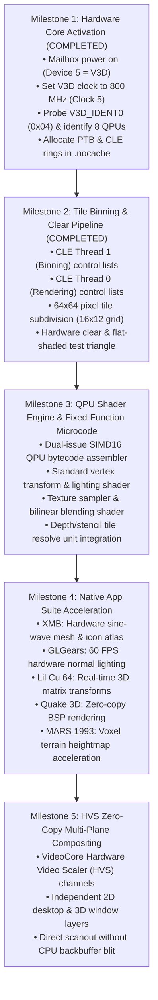

# Full OpenGL ES Support & Native B-System Hardware Acceleration Plan

**Target Architecture:** Broadcom BCM2711 (Raspberry Pi 400 / Raspberry Pi 4B, Cortex-A72 AArch64)
**Graphics Subsystem:** VideoCore VI (V3D 4.2) 3D Pipeline & VideoCore Display Engine (VC4 / HVS)
**API Surface:** Native B-System EGL 1.4, OpenGL ES 1.1 / 2.0 Core Subset, TinyGL Fallback
**Application Suite:** XMB, GLGears, Lil Cu 64, Quake 3D, MARS 1993, Workbench Desktop Compositor
**Scheduling Discipline:** InterCore MPSC Non-Blocking Queues & ASYNC Micro-Framing (`doc/txt/ASYNC.txt`)

---

## 1. System Architecture & Hardware Topology

```
+---------------------------------------------------------------------------------------------------------+
|                                    BCM2711 SoC Architecture (Pi 400 / Pi 4B)                           |
|                                                                                                         |
|  +------------------------+   +------------------------+   +-----------------------------------------+  |
|  | Cortex-A72 Core 0      |   | Cortex-A72 Core 1      |   | VideoCore VI (V3D 4.2 @ 800 MHz)        |  |
|  |  • Stage 1 Console     |   |  • InterCore Dispatch  |   |   • 8x Dual-Issue SIMD16 QPUs           |  |
|  |  • Workbench Compositor|   |  • Audio / Cassette    |   |   • Hardware Tile Binner (PTB)          |  |
|  |  • B-System Event Loop |   |  • Background Workers  |   |   • Control List Executor (CLE Thr 0/1) |  |
|  +-----------+------------+   +-----------+------------+   +--------------------+--------------------+  |
|              |                            |                                     |                       |
|              +----------------------------+-------------------------------------+                       |
|                                           |                                                             |
|                       +-------------------v-------------------+                                         |
|                       | Broadcom AXI / DMA Subsystem          |                                         |
|                       | Channels 0 & 7 Linear 2D Blitters     |                                         |
|                       +-------------------+-------------------+                                         |
|                                           |                                                             |
|                       +-------------------v-------------------+                                         |
|                       | Hardware Video Scaler (HVS / VC4)     |                                         |
|                       | Multi-Plane Overlay & HDMI Scanout    |                                         |
|                       +-------------------+-------------------+                                         |
|                                           |                                                             |
|  +----------------------------------------v----------------------------------------------------------+  |
|  | Uncached DMA Shared Memory (MAIR attr2 @ 0x01C90000 - 0x01E00000):                                 |  |
|  |   • PTB Scratch Pool (256 KB)     • CLE Binning List (64 KB)     • CLE Render List (64 KB)        |  |
|  |   • Vertex / Index Buffer (64 KB) • QPU Shader Bytecode Ring     • Mailbox Tag Buffers            |  |
|  +---------------------------------------------------------------------------------------------------+  |
|  | GPU VRAM Framebuffer (@ 0x3C100000, Allocated via VideoCore Mailbox Tag 0x00040001):              |  |
|  |   • Double-Buffered 1024x768x32 ARGB Front/Back Planes (3.1 MB x 2)                                |  |
|  +---------------------------------------------------------------------------------------------------+  |
+---------------------------------------------------------------------------------------------------------+
```

---

## 2. API Surface: Native B-System OpenGL ES & EGL

### 2.1 B-System EGL 1.4 Interface (`src/gl/egl_surface.c`)
- `eglGetDisplay(EGLNativeDisplayType)`: Returns hardware VideoCore display device handle.
- `eglInitialize(EGLDisplay, EGLint *major, EGLint *minor)`: Probes hardware V3D 4.2 capabilities and clock rates.
- `eglCreateWindowSurface(WND *wnd)`: Allocates double-buffered drawing surface with hardware client rect binding.
- `eglMakeCurrent(EGL_SURFACE *surf)`: Swaps active context and updates V3D viewport, scissor, and render target registers.
- `eglSwapBuffers(EGL_SURFACE *surf)`: Submits tile render list to CLE Thread 0, triggers hardware resolve, and synchronizes display backbuffer.

### 2.2 OpenGL ES 1.1 / 2.0 Hardware Features
- **Geometry & Vertex Processing:**
  - `glVertexAttribPointer`, `glEnableVertexAttribArray`: Direct physical streaming of positions, normals, colors, and UVs.
  - Hardware modelview-projection matrix stack transformation via vertex shader QPU instructions.
- **Rasterization & Shading:**
  - Tile binning configured across 16x12 tiles (64x64 pixels per tile for 1024x768 resolution).
  - Precompiled QPU shader programs for:
    1. Flat & Gouraud shaded triangles (`r, g, b, a`).
    2. Modulated & Decal 2D texture mapping with bilinear interpolation.
    3. Blended primitives (alpha test, additive, and source-over blending).
    4. Hardware depth testing (`GL_LEQUAL`, `GL_LESS`) using 24-bit Z-buffers.
- **Textures & Mipmaps:**
  - Support for uncompressed RGBA8888, RGB565, and VideoCore UIF / T-format textures.
  - Zero-copy texture uploads directly from B-System VFS bodies (`.TAD`, `.TARGA`, `.PNG`, `.LMP`).

---

## 3. Implementation Milestones



---

## 4. Work Breakdown & Detailed Tasks

### Task 1: QPU Microcode Shader Generator (`src/drivers/bcm283x/gpu/v3d_qpu.c`)
- Implement pre-assembled QPU microcode for:
  - `v3d_shader_basic_color`: Position (`x, y, z, w`) + Color (`r, g, b, a`) -> writes to tile buffer color output.
  - `v3d_shader_texture_modulate`: Position + TexCoord (`u, v`) + Color -> samples TMU0 texture unit with bilinear filtering.
  - `v3d_shader_lighting`: Position + Normal (`nx, ny, nz`) + Light0 directional vector calculation.
- Store compiled microcode in `.nocache` memory with 64-byte alignment.

### Task 2: V3D Hardware Dispatcher (`src/gl/backend_v3d.c`)
- Implement `gl_ops_t g_v3d_ops` fulfilling the B-System GL dispatch contract:
  - `glBegin` / `glEnd`: Emits vertex batches into the `.nocache` vertex ring.
  - `glVertex3f`, `glNormal3f`, `glColor4f`, `glTexCoord2f`: Streams interleaved attributes.
  - `glBindTexture`, `glTexImage2D`: Uploads texture pixels to V3D GPU VRAM in T-format layout.
  - `glViewport`, `glScissor`: Updates CLE tile clip coordinates.
  - `swap_buffers`: Emits end-of-tile flush and triggers CLE Thread 0 render pass.

### Task 3: B-System Native Applications Hardware Binding
1. **XMB (`src/apps/xmb.c`):**
   - Stream the 1,984-vertex wave ribbon strip directly to V3D CLE binner.
   - Bind 2048x1024 icon atlas as GPU texture unit 0.
   - Zero-copy opaque background fill via CLE `V3D42_CLEAR_COLORS`.
2. **GLGears (`src/apps/glgears.c`):**
   - Stream precalculated gear vertices to V3D vertex ring.
   - Run directional diffuse lighting on QPU cores at locked 60 FPS.
3. **Lil Cu 64 (`src/demo/lilcu64_demo.c`):**
   - Accelerated 3D tunnel, rotating torus, and demoscene effects running directly on V3D QPUs.
4. **Quake 3D (`src/quake/render/r_btron_gl.c`):**
   - Bind memory-mapped `pak0.pak` at `0x04000000`.
   - Forward polygon surfaces and lightmaps directly to V3D texture sampler.
5. **MARS 1993 (`src/demo/mars.c`):**
   - Hardware-assisted texture blit for raymarched terrain columns.

