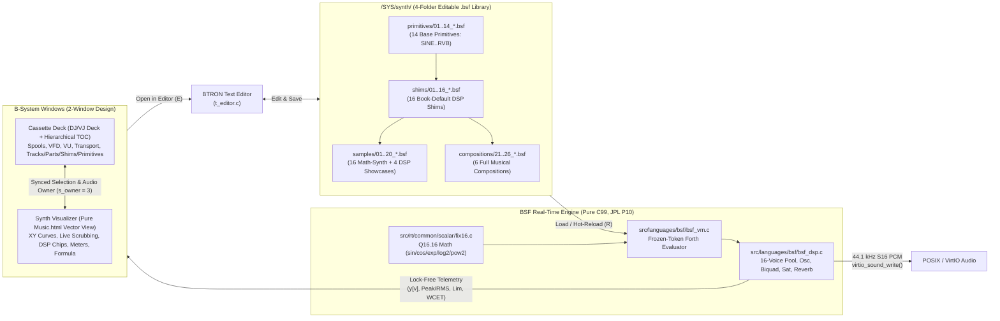

# Implementation Plan: B-System Synth Visualizer & Cassette DJ/VJ Deck (B-Sound Forth)

## 1. Architecture & Confirmed Design Decisions

Implement a native **B-System Synth & Cassette BSF Engine** in pure C99 (strictly adhering to **NASA/JPL Power of Ten** rules: zero heap allocation on the audio plane, statically bounded arrays/loops, deterministic WCET ≤ **666 µs** per 32-sample block at 44.1 kHz):

1. **Visual Resemblance & Mathematical/Sonic Conformance to [Music.html](file:///Users/tonpa/depot/msx-btron/edu/Music.html)**:
   - **Visual Resemblance**: Faithfully reproduces the minimal HAL-9000 vector aesthetic of `Music.html` using native BTRON graphics (`dp.h`, `APP_MENU_BAR`, `troncode.h`) — obsidian canvas (`#050609`), amber (`#E8A454`), cyan (`#7FD4CC`), HAL red (`#D93829`), paper (`#E6E1D6`), 12-color voice palette (`V_COLS`), ISO-16 pitch grid (C2–C6), live red vertical playhead with glowing active pitch dots, top telemetry strip, bottom 14-marker DSP voice chips + stereo Peak/RMS/LIM/balance meters + formula readout, and matching keyboard/mouse-drag scrubbing ergonomics.
   - **Mathematical & Sonic Conformance**: Exact pitch law $f(y) = 261.6256 \cdot 2^y\,\text{Hz}$ (C4 at $y=0$, $x \in [-8, +8]$), 1:1 analytical & shim behavior across all 14 primitives, 16 book-default shims, and all 26 compositions verified numerically against [synth-engine.js](file:///Users/tonpa/depot/msx-btron/edu/synth-engine.js) within < 1 cent.
2. **All 26 Entries Encoded as Editable `.bsf` Files (`/samples/` & `/compositions/`)**:
   - **`/SYS/synth/samples/`** (20 entries): Demos `01`–`16` Math-Synth multi-part analytical demos + `17`–`20` B-Sound Virtual DSP Shim Showcases from [synth-engine.js](file:///Users/tonpa/depot/msx-btron/edu/synth-engine.js).
   - **`/SYS/synth/compositions/`** (6 entries): Full Musical Compositions `21`–`26` (*Carol of the Bells*, *Green Caterpillar*, *House of the Rising Sun*, *TRON Init*, *Electro Glide in Blue*, *Carla Bley — 440*).
3. **Clean Two-Window Design (No Redundant Mini-TOC)**:
   - **Cassette Deck (`open_audio_player_window()`) — Unified DJ/VJ Event Controller & Hierarchical TOC**:
     - Consolidates transport, tape-deck instrumentation, and Clarity-style TOC navigation into one window—eliminating the duplication of a separate TOC mini-window.
     - Upper section: Classic B-System Stereo Cassette Deck (dual rotating spools, VFD counter, Tape Type / Dolby / HX Pro badges, 16-segment stereo LED VU meters, full Transport Bar `REW / REV / PLAY / FF / STOP / PAUSE / REC`).
     - Lower section (`layout.pl_box`, upgraded with Clarity's `12 px` mini vertical scrollbar, `18 px` rows, mouse-wheel & `↑/↓` keyboard navigation, and hover/active highlights): **Hierarchical DJ/VJ TOC** organized by folder (`COMPOSITIONS 21–26`, `SAMPLES: MATH-SYNTH 01–16`, `SAMPLES: B-SOUND DSP 17–20`, `ORCHESTRA / LEGACY`, `DSP SHIMS 01–16`, and `PRIMITIVES 01–14`), with **expandable items (`▸`/`▾`) down to individual Parts** (`Part 1..N`). Clicking a composition/sample or part cues & plays it immediately; clicking a shim or primitive opens its `.bsf` in `t_editor`.
   - **Synth Window (`open_synth_window()`) — Pure Minimal Visualizer Window**:
     - Stays strictly focused and uncluttered, faithful to [Music.html](file:///Users/tonpa/depot/msx-btron/edu/Music.html): HAL-9000 dark vector canvas plotting multi-voice analytical pitch curves $y_v(x)$ across $x \in [-8, +8]$, live red playhead cursor with mouse-drag scrubbing, minimal top telemetry strip (`HAL eye`, Track `#/26` + Name + Part, `PLAY/PAUSE`, `DECK`, `EDIT`, `RUN`), and minimal bottom DSP/meter/formula strip.
     - Full keyboard shortcuts (`Space`, `←/→` track, `↑/↓` or `1–8` part, `E` edit `.bsf`, `R` reload & rerun, `C` focus Cassette Deck) stay 100% synced with Cassette Deck.
4. **Clean 4-Folder Editable BSF Library (`/SYS/synth/`)**:
   - **`/SYS/synth/primitives/` (14 Base DSP Primitives)**: Separate, clean base-library folder containing one `.bsf` file for each of the 14 canonical primitives (`SINE`, `TRI`, `SAW`, `PLS`, `FM`, `AM`, `NSE`, `SAT`, `LPF`, `HPF`, `BPF`, `LFO`, `PNO`, `RVB`) matching [Music.html](file:///Users/tonpa/depot/msx-btron/edu/Music.html#L280-L336).
   - **`/SYS/synth/shims/` (16 DSP Shims)**: Built on top of `/primitives/`, implementing the exact canonical book defaults (frequencies, partial ratios, envelopes, filter cutoffs/$Q$, WaveShaper $k$) from [ch04-shims.tex](file:///Users/tonpa/depot/msx-btron/edu/book/chapters/ch04-shims.tex).
   - **`/SYS/synth/samples/` (20 Analytical & DSP Showcase Samples)**: Demos `01`–`20`, built on `/primitives/` and `/shims/`.
   - **`/SYS/synth/compositions/` (6 Full Musical Compositions)**: Tracks `21`–`26`, built on `/primitives/` and `/shims/`.
5. **Live Edit & Rerun Workflow**:
   - Opening any primitive `.bsf`, shim `.bsf`, sample `.bsf`, or composition `.bsf` from Cassette or Synth launches BTRON's native Text Editor ([t_editor.c](file:///Users/tonpa/depot/msx-btron/btron/src/apps/editor/t_editor.c)) via `open_t_editor_window_with_file()`. Saving in Editor and pressing **Reload/Rerun (`R`)** recompiles `primitives → shims → active track` into the frozen token arena and resumes playback immediately (reporting any Forth syntax error cleanly in the status bar without crashing).
6. **First Verification Target**: **`make run-posix`** (`btron-posix` + `downloads/btron_sys.vol`).

---

## 2. Implementation Phases

### Phase 1: Q16.16 Fixed-Point Real-Time Math (`btron/src/rt`)

- **[NEW] `btron/include/rt/fix16.h`**
  - `typedef int32_t fix16_t;` (`FIX16_ONE = 65536`, `FIX16_QUIET = INT32_MIN` silence/NaN sentinel).
  - Arithmetic: `fix16_from_int`, `fix16_to_int`, `fix16_mul`, `fix16_div`, `fix16_clamp`, `fix16_abs`, `fix16_floor`, `fix16_frac`, `fix16_mod`.
  - Transcendentals: `fix16_sin`, `fix16_cos`, `fix16_exp`, `fix16_log2`, `fix16_pow2`, `fix16_tanh`, `fix16_waveshaper` ($C_k(x)$ from B-Sound Eq. 14).
  - Pitch law: `fix16_y_to_hz(y)` ($261.6256 \cdot 2^y$), `fix16_hz_to_y(f)` ($\log_2(f / 261.6256)$).
  - Analytical helpers matching `synth-engine.js`: `fix16_bit(mask, k)`, `fix16_digit(num, idx)`, `fix16_diat(d)`.
- **[NEW] `btron/src/rt/common/scalar/fix16.c`**
  - 256-entry sine table with linear interpolation; range-reduced minimax polynomials for `exp`, `log2`, `pow2` (< 1 cent pitch error across C1–C8); pure C99 compatible with Cortex-M0/M55 and POSIX.

---

### Phase 2: B-Sound Forth (BSF) VM & DSP Core (`btron/src/languages/bsf`)

- **[NEW] `btron/include/btron/bsf.h`**
  - Static 16-voice pool (`BsfVoice[16]`): `active`, `wave_mode` (`SINE/TRI/SAW/PLS/FM/AM/NSE/SAT/LPF/HPF/BPF/LFO/PNO/RVB`), Q32 phase, `y_pitch`, `freq_hz`, `amp`, `pan`, ADSR envelope state, biquad state (`z1, z2, b0, b1, b2, a1, a2`), FM ratio/index, WaveShaper `k`, vibrato LFO state, AM rasp state.
  - `BsfTelemetry`: `x_pos`, `part_idx`, `part_count`, `voice_count`, `voice_y[16]`, `voice_mode[16]`, `voice_active[16]`, `peak_l`, `peak_r`, `rms_l`, `rms_r`, `limiter_hit`, `balance`, `wcet_us`, `sample_counter`, `last_error[128]`.
  - `BsfTrackInfo` catalogue entry (`BSF_MAX_TRACKS = 32`): `id`, `title`, `category`, `parts`, `part_names[20][40]`, `speed`, `reverb`, `formula`, `filepath`.
  - Lifecycle & control API:
    - `bsf_init(uint32_t sample_rate)`, `bsf_close(void)`
    - `bsf_scan_tracks(void)` — discovers `/SYS/synth/samples/*.bsf` and `/SYS/synth/compositions/*.bsf` (with `assets/synth/samples/` & `assets/synth/compositions/` host fallback) and parses metadata headers (`\ @ID`, `\ @TITLE`, `\ @CATEGORY`, `\ @PARTS`, `\ @PART`, `\ @SPEED`, `\ @FORMULA`).
    - `bsf_load_shim_bank(void)` — compiles all 16 `.bsf` shims into the base dictionary watermark.
    - `bsf_load_track(int track_idx)` / `bsf_set_part(int part_idx)` / `bsf_reload(void)` — resets to shim watermark, compiles track `.bsf`, resolves `TRACK-EVAL` / `TRACK-TICK`, hot-reloads cleanly after Editor saves.
    - `bsf_render_frames(int16_t *out_pcm, size_t frames)` — 32-sample quantum render loop, 4-comb Schroeder reverb + `master_soft_clamp()`, WCET timing.
    - `bsf_audio_pump(void)` — pumps PCM into `virtio_sound_write()` for `cassette_service()`.
    - `bsf_eval_preview(fix16_t x, int part_idx, fix16_t *out_y, uint8_t *out_modes, int max_voices)` — pure evaluation pass for pre-rendering the full `x ∈ [-8, +8]` curves in the Synth Visualizer Window.
- **[NEW] `btron/src/languages/bsf/bsf_vm.c`**
  - Compile-time text parser (load/reload only, never on audio plane): `:`, `;`, `CONSTANT`, `VARIABLE`, `CREATE`, `ALLOT`, `IF`/`ELSE`/`THEN`, `DO`/`LOOP`/`I`/`J`, `BEGIN`/`WHILE`/`REPEAT`/`UNTIL`, `CASE`/`OF`/`ENDOF`/`ENDCASE`, `DUP`, `DROP`, `SWAP`, `OVER`, `ROT`, `PICK`, `>R`, `R>`, `R@`, `INCLUDE`, `\` and `(...)` comments, integer & decimal Q16.16 literals (`0.16`, `-2.5`, `7 F16`).
  - Frozen-token inner interpreter with bounded step count (NASA/JPL Power of Ten).
- **[NEW] `btron/src/languages/bsf/bsf_dsp.c`**
  - Native DSP token primitives:
    - Math/Analytical: `F16`, `F*`, `F/`, `*/`, `MOD`, `ABS`, `NEGATE`, `MIN`, `MAX`, `CLAMP`, `CLAMP01`, `SMOOTHSTEP`, `SIN`, `COS`, `EXP`, `LOG2`, `POW2`, `FRAC`, `FLOOR`, `BIT`, `DIGIT`, `DIAT`, `HZ>Y`, `Y>HZ`, `QUIET`.
    - Synthesis/Filter: `PHASE+`, `OSC-SINE`, `OSC-TRI`, `OSC-SAW`, `OSC-PULSE`, `OSC-NOISE`, `OSC-FM`, `SAT`, `BIQUAD-LP!`, `BIQUAD-HP!`, `BIQUAD-BP!`, `BIQUAD-TICK`.
    - Voice/Transport: `VOICE-ALLOC`, `VOICE-FREE`, `VOICE-FREQ!`, `VOICE-Y!`, `VOICE-AMP!`, `VOICE-PAN!`, `VOICE-MODE!`, `VOICE-ENV!`, `VOICE-SWEEP!`, `VOICE-ON`, `VOICE-OFF`, `REVERB!`, `SAMPLES@`, `X@`, `PART@`, `EV-EVAL`.

---

### Phase 3: Clean Base Library — 14 DSP Primitives (`btron/assets/synth/primitives/`)

Create a dedicated, clean base-library folder `btron/assets/synth/primitives/` (packaged to `/SYS/synth/primitives/` via [manifest.txt](file:///Users/tonpa/depot/msx-btron/btron/tools/manifest.txt)) with 14 standalone, editable `.bsf` files plus a `primitives.bsf` master loader:

| # | File | Marker | BSF Words & Mathematical Role (`Music.html`) |
|---|---|---|---|
| 01 | `01_sine.bsf` | `○ SINE` | `PRIM-SINE` — Pure & sub-weighted sine oscillator $w(\varphi)=\sin(\varphi)$ |
| 02 | `02_tri.bsf` | `△ TRI` | `PRIM-TRI` — Triangle oscillator $(2/\pi)\arcsin(\sin\varphi)$ |
| 03 | `03_saw.bsf` | `◿ SAW` | `PRIM-SAW` — Band-limited 4-harmonic sawtooth |
| 04 | `04_pls.bsf` | `⊓ PLS` | `PRIM-PLS` — Band-limited pulse/square $0.78\tanh(3.4\sin\varphi)$ |
| 05 | `05_fm.bsf` | `◇ FM` | `PRIM-FM` — 2-Op FM $\sin(\varphi + I\sin(r\varphi))$ (Eq. 12) |
| 06 | `06_am.bsf` | `⊗ AM` | `PRIM-AM` — Tremolo / Ring-mod amplitude modulation (Eq. 19) |
| 07 | `07_nse.bsf` | `✕ NSE` | `PRIM-NSE` — Deterministic xorshift32 white noise $\xi[n]$ |
| 08 | `08_sat.bsf` | `□ SAT` | `PRIM-SAT` — WaveShaper saturation $C_k(x)$ (Eq. 14) |
| 09 | `09_lpf.bsf` | `⤓ LPF` | `PRIM-LPF` — Resonant low-pass biquad $H_{\mathrm{LP}}(z)$ (Eq. 13) |
| 10 | `10_hpf.bsf` | `⤒ HPF` | `PRIM-HPF` — High-pass biquad $H_{\mathrm{HP}}(z)$ (Eq. 13) |
| 11 | `11_bpf.bsf` | `⟐ BPF` | `PRIM-BPF` — Formant band-pass biquad $H_{\mathrm{BP}}(z)$ (Eq. 13) |
| 12 | `12_lfo.bsf` | `≈ LFO` | `PRIM-LFO` — Delayed vibrato / ribbon drift LFO (Eq. 17) |
| 13 | `13_pno.bsf` | `PNO` | `PRIM-PNO` — Acoustic piano-drop / hammer pluck (4 damped partials + echo) |
| 14 | `14_rvb.bsf` | `◎ RVB` | `PRIM-RVB` — 4-comb Schroeder hall reverb ($g=0.78$, Eq. 15) |

---

### Phase 4: Bank of 16 DSP Shims with Exact Book Defaults (`btron/assets/synth/shims/`)

All 16 `.bsf` shim files packaged to `/SYS/synth/shims/` via [manifest.txt](file:///Users/tonpa/depot/msx-btron/btron/tools/manifest.txt), composed cleanly from `/SYS/synth/primitives/` using the exact canonical default parameters from [ch04-shims.tex](file:///Users/tonpa/depot/msx-btron/edu/book/chapters/ch04-shims.tex):

| # | File | BSF Word | Book Default Parameters (`ch04-shims.tex`) |
|---|---|---|---|
| 01 | `01_pulse_squash.bsf` | `SHIM-PULSE-SQUASH` | 6 sine partials C4..E6, $0.97f \to f$ ($0.10\,\text{s}$), $0.09\,\text{s}$ att |
| 02 | `02_frog_croak.bsf` | `SHIM-FROG-CROAK` | $f_b=125\,\text{Hz}$ ($d=0.19\,\text{s}$), $2.45f_b$ tri, BP $2.2f_b$ ($Q=3.8$), $32.26\,\text{Hz}$ AM |
| 03 | `03_pulse_bell.bsf` | `SHIM-PULSE-BELL` | 2-Op FM ($r=2.76, I=1.8$, $\tau=1.8\,\text{s}$) |
| 04 | `04_waddle.bsf` | `SHIM-WADDLE` | $f_0=430\,\text{Hz}$ ($d=0.08\,\text{s}$), tri $f_0 \to 0.82f_0$, LP $180\,\text{Hz}$ |
| 05 | `05_float.bsf` | `SHIM-FLOAT` | $f_0=523.25\,\text{Hz}$, 4 staggered sines ($0, 60, 120, 180\,\text{ms}$), $0.985f \to f$ |
| 06 | `06_dance.bsf` | `SHIM-DANCE` | 5-note D-major sine cascade (D5..F#6, $0..0.37\,\text{s}$, $20\,\text{ms}$ att) |
| 07 | `07_ding.bsf` | `SHIM-DING` | $f_0=1760\,\text{Hz}, d=0.70\,\text{s}$, pure sine, $12\,\text{ms}$ att |
| 08 | `08_kick.bsf` | `SHIM-KICK` | $f_0=65\,\text{Hz}, d=0.16\,\text{s}$, sine $2.2f_0 \to 0.75f_0$ |
| 09 | `09_snare.bsf` | `SHIM-SNARE` | Tri shell $175/220 \to 0.65f_b$ ($0.12\,\text{s}$) + BP noise $2400/3200\,\text{Hz}$ ($Q=2.0$) |
| 10 | `10_hihat.bsf` | `SHIM-HIHAT` | HP $7500\,\text{Hz}$ noise + sine ping $8400/6200\,\text{Hz}$ ($d=0.055/0.28\,\text{s}$) |
| 11 | `11_guitar.bsf` | `SHIM-GUITAR` | Tri + LP sweep $2800 \to 1400\,\text{Hz}$, $15\,\text{ms}$ thumb-pick att |
| 12 | `12_grand_piano.bsf` | `SHIM-GRAND-PIANO` | 3 inharmonic partials $\{1.0, 2.002, 3.006\}$ (sin/tri/sin), $8\,\text{ms}$ att |
| 13 | `13_pedal_bass.bsf` | `SHIM-PEDAL-BASS` | $f_0=55\,\text{Hz}, d=2.2\,\text{s}$, tri $f_0 \to 0.98f_0$ sag |
| 14 | `14_ind_kick.bsf` | `SHIM-IND-KICK` | $d=0.22\,\text{s}$, sine $160 \to 42\,\text{Hz}$ + tri $380 \to 55\,\text{Hz}$ $\to$ LP $1800$ $\to C_{25}$ |
| 15 | `15_ind_bass.bsf` | `SHIM-IND-BASS` | Saw $f_0$ + Sq $1.005f_0$ $\to$ LP $2600 \to 420\,\text{Hz}$ ($Q=4.5$) $\to C_{20}$ |
| 16 | `16_cyber_lead.bsf` | `SHIM-CYBER-LEAD` | Saw $f_0$ + Sq $1.004f_0$ $\to$ LP $3800 \to 1600\,\text{Hz}$ ($Q=4.0$) $\to C_{25}$ |

---

### Phase 5: All 26 Entries — `/samples/` (20) & `/compositions/` (6)

Encode all **26 entries** (including their multi-part variants) from [synth-engine.js](file:///Users/tonpa/depot/msx-btron/edu/synth-engine.js) as clean, editable `.bsf` files split across two folders:

- **`btron/assets/synth/samples/` → `/SYS/synth/samples/` (20 files)**:
  - **Math-Synth Analytical Series (`01`–`16`)**: `01_harmonic_fan.bsf` (4 parts), `02_burgundy_groove.bsf` (6 parts), `03_motor_chord.bsf` (4 parts), `04_sub_swell.bsf` (3 parts), `05_lime_breakbeat.bsf` (4 parts), `06_cobalt_euclid.bsf` (4 parts), `07_crimson_acid.bsf` (4 parts), `08_mint_swing.bsf` (4 parts), `09_emerald_acid.bsf` (4 parts), `10_violet_drift.bsf` (3 parts), `11_bronze_pulse.bsf` (3 parts), `12_obsidian_canon.bsf` (3 parts), `13_sage_funk.bsf` (2 parts), `14_sapphire_arp.bsf` (2 parts), `15_neon_pluck.bsf` (2 parts), `16_analytical_etudes.bsf` (18 parts: Broken Radio → Zimmer → Aphex Twin → Mosaic).
  - **B-Sound Virtual DSP Showcase (`17`–`20`)**: `17_bsound_kinematic.bsf`, `18_bsound_percussion.bsf`, `19_bsound_orchestra.bsf`, `20_bsound_industrial.bsf`.
- **`btron/assets/synth/compositions/` → `/SYS/synth/compositions/` (6 files)**:
  - **B-Sound Full Musical Compositions (`21`–`26`)**: `21_carol_of_bells.bsf`, `22_green_caterpillar.bsf`, `23_house_of_rising_sun.bsf`, `24_tron_init.bsf`, `25_electro_glide.bsf`, `26_carla_bley_440.bsf`.

---

### Phase 6: Unified Cassette DJ/VJ TOC Deck & Pure Synth Visualizer Window

#### 6.1 Cassette Deck — DJ/VJ Event Controller & Hierarchical TOC (`btron/src/media/cassette/audio_player.c`)
- Add audio owner `s_owner = 3` (**BSF Synth Engine**) pumped inside `cassette_service()`.
- Upgrade `layout.pl_box` (resizable height) into a **Clarity-style Hierarchical TOC Playlist**:
  - `18 px` rows, `12 px` mini vertical scrollbar with crisp stepper triangles & drag thumb (matching `clarity.c`), mouse-wheel scroll (`EV_KEY_FROM_WHEEL`), hover & active row highlights, and `↑/↓/j/k/PgUp/PgDn/Enter/Space` keyboard navigation.
  - Structured sections:
    1. `COMPOSITIONS (21–26)` — expandable (`▸`/`▾`) full musical compositions from `/SYS/synth/compositions/` revealing `Part 1..N` child rows.
    2. `SAMPLES: MATH-SYNTH (01–16)` — expandable analytical demos from `/SYS/synth/samples/` + parts.
    3. `SAMPLES: B-SOUND DSP (17–20)` — expandable shim showcase samples from `/SYS/synth/samples/` + parts.
    4. `ORCHESTRA / LEGACY` — preserves existing 4 built-in demo scores + `orchestra.orch` + `orchestra.mid`.
    5. `DSP SHIMS (01–16)` — 16 editable shim `.bsf` entries from `/SYS/synth/shims/` (clicking opens in `t_editor`).
    6. `PRIMITIVES (01–14)` — 14 editable base-library primitive `.bsf` entries from `/SYS/synth/primitives/` (`SINE`..`RVB`, clicking opens in `t_editor`).
  - Clicking a track or part cues & plays it on the deck (driving dual tape spools, VFD counter, 16-segment L/R LED VU meters, and syncing the Synth Visualizer Window live).
  - Add footer / menu controls: **Visualizer** (opens/focuses Synth Visualizer Window), **Edit .bsf** (opens selected track/shim/primitive in `t_editor`), and **Reload** (hot-recompiles `primitives → shims → track` & reruns).

#### 6.2 Synth Visualizer Window (`btron/src/media/synth/synth_app.c` + `btron/include/media/synth.h`)
- Pure, uncluttered HAL-9000 / `Music.html` dark vector display (`760 × 520`, resizable) using native BTRON graphics (`dp.h`, `APP_MENU_BAR`, `drw_tc_string`).
- **Top Strip**: HAL status eye, Track `#/26` + Name + Part `p/N`, quick pills (`PLAY/PAUSE`, `DECK`, `EDIT`, `RUN`).
- **Vector Pitch Canvas**: ISO-16 pitch grid (C2–C6), pre-evaluated analytical voice curves $y_v(x)$ in 12 vector colors, live red vertical playhead cursor at $x \in [-8, +8]$ with glowing active pitch dots, click/drag scrubbing.
- **Bottom Telemetry & Formula Strip**: Active DSP voice chips (`SINE/TRI/SAW/PLS/FM/AM/NSE/SAT/LPF/HPF/BPF/LFO/PNO/RVB`), stereo L/R peak/RMS bar meters, `LIM` hit indicator, stereo balance dot, WCET µs readout, formula & compile-error display.
- **Menu & Shortcuts**:
  - `File(F)`: Open Cassette Deck / TOC (`C`), Edit Track `.bsf` (`E`), Reload & Rerun (`R`), Close.
  - `Primitives(P)`: Quick-open any of the 14 `.bsf` primitives (`SINE`..`RVB`) in `t_editor`.
  - `Shims(S)`: Quick-open any of the 16 `.bsf` shims in `t_editor`.
  - `Transport(T)`: Play/Pause (`Space`), Prev/Next Track (`←/→`), Prev/Next Part (`↑/↓`, `1–8`), Auto-Advance (`A`), Mute (`M`).

#### 6.3 Desktop, CLU, & Build Wiring
- Register `open_synth_window()` in `btron/include/btron/apps.h`, `btron/src/apps/workbench/global_menu.c`, and `btron/src/apps/clu/clu.c` (`synth` command).
- Wire new sources (`fix16.c`, `bsf_vm.c`, `bsf_dsp.c`, `synth_app.c`) into `btron/Makefile` (`POSIX_SRCS` & shared media targets) and add all **14 primitive + 16 shim + 20 sample + 6 composition `.bsf`** files (`primitives/`, `shims/`, `samples/`, `compositions/`) to `btron/tools/manifest.txt`.

---

## 3. Verification Plan

1. **Automated Unit & Regression Suite (`btron/verify/tests/test_bsf_vm.c`)**:
   - Verify Q16.16 math accuracy (`sin`, `cos`, `exp`, `log2`, `pow2` within < 1 cent).
   - Compile & validate **all 14 primitive `.bsf`**, **all 16 shim `.bsf`**, **all 20 sample `.bsf`**, and **all 6 composition `.bsf`** files with zero errors.
   - Verify **Music.html / synth-engine.js conformance**: cross-check evaluated pitch vectors $y_v(x)$ across all 26 tracks against `synth-engine.js` reference values (< 1 cent tolerance) and visually compare Synth Visualizer layout, palette, voice chips, meters, and scrubbing against `Music.html`.
   - Measure 32-sample block WCET (verify ≪ 666 µs).
   - Verify hot-reload after editing a `.bsf` source buffer and graceful error handling on invalid Forth syntax.
2. **POSIX Build & Interactive Test (`cd btron && make run-posix`)**:
   - Clean build of `btron-posix` and `downloads/btron_sys.vol` with zero compiler warnings.
   - Launch Cassette Deck (verify Clarity-style scrollable TOC with expandable compositions → parts + shims + primitives) and Synth Visualizer Window (verify XY curves, live scrubbing, telemetry, and synced transport).
   - Open a primitive `.bsf`, a shim `.bsf`, and a track `.bsf` in `t_editor`, edit, save, press `R` (Reload & Rerun), and verify immediate audible + visual update.
