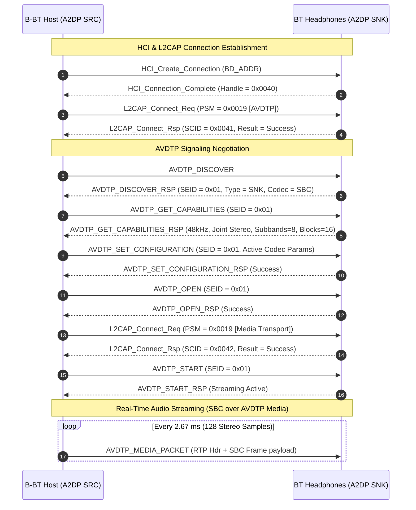
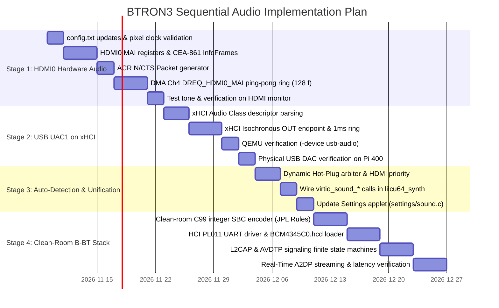

Pi 400 Sound Delivery
=====================

# BTRON3 BCM2711 AArch64 Audio Architecture & Implementation Plan

## Native HDMI MAI, USB UAC1 Fallback & Clean-Room B-BT Bluetooth Stack (NASA JPL Compliant)

**Target Architecture:** Broadcom BCM2711 (Raspberry Pi 400 / Pi 4B, Cortex-A72 AArch64 Bare-Metal)
**Execution Priority 1:** Native Hardware HDMI Audio via VideoCore VI MAI & DMA Engine
**Execution Priority 2:** USB Audio Class 1.0 (UAC1) on VIA VL805 xHCI (Hardware Fallback & QEMU Verifiable)
**Execution Priority 3:** B-BT Clean-Room Bluetooth Audio Stack (Full A2DP v1.3.2 Spec, NASA JPL Power of 10 Compliant)
**Dynamic Policy:** Hardware auto-detection with strict priority: **HDMI (Active) $\rightarrow$ USB DAC $\rightarrow$ B-BT Wireless $\rightarrow$ VirtIO**
**Latency Targets:** HDMI MAI $\le 2.67\text{ ms}$ | USB UAC1 $\le 4.0\text{ ms}$ | B-BT A2DP $\le 15\text{--}20\text{ ms}$ (Real-Time Budgeted)

## 1. System Topology & Dynamic Routing Matrix

The Raspberry Pi 400 has no 3.5 mm analog audio jack. Sound delivery is arbitrated dynamically across three physical tiers and one simulation tier:

```
+---------------------------------------------------------------------------------------------------------+
|                                  B-System Dynamic Audio Routing Pipeline                                |
|                                                                                                         |
|  +---------------------------------------------------------------------------------------------------+  |
|  | Applications / Subsystems: Cassette Deck, Lil Cu 64 Synth, Orchestra (gst_rt), tronMSX Audio      |  |
|  +-------------------------------------------------+-------------------------------------------------+  |
|                                                    |                                                    |
|                                                    v                                                    |
|  +---------------------------------------------------------------------------------------------------+  |
|  | Unified B-Audio Driver: virtio_sound_open() / write() / close() / get_queued_bytes()              |  |
|  +-------------------------------------------------+-------------------------------------------------+  |
|                                                    |                                                    |
|                                                    v                                                    |
|  +---------------------------------------------------------------------------------------------------+  |
|  | Dynamic Hardware Arbiter & Priority Dispatch (src/drivers/broadcom/bcm2711_audio.c)               |  |
|  | Policy: HDMI0 Connected? ===[ YES ]===> [ TIER 1: Native HDMI0 MAI DMA Engine ]                   |  |
|  |                             ===[ NO  ]===> USB DAC Attached? ===[ YES ]===> [ TIER 2: USB UAC1 ]  |  |
|  |                                                              ===[ NO  ]===> BT Connected?         |  |
|  |                                                                             ===[ YES ]=> [TIER 3] |  |
|  +-------------------+-----------------------------+-------------------------------+-----------------+  |
|                      |                             |                               |                    |
|                      v                             v                               v                    v
|  +-------------------------+ +---------------------------+ +-----------------------------+ +----------------+
|  | [TIER 1: FIRST PRIORITY]| | [TIER 2: SECOND PRIORITY] | | [TIER 3: NASA JPL CLEANROOM]| | [SIMULATION]   |
|  | Native HDMI0 MAI Driver | | USB Audio Class 1.0 (UAC1)| | B-BT A2DP Audio Stack       | | VirtIO-Sound   |
|  | • Base: 0xFEF20000      | | • xHCI Isochronous Ring   | | • Full A2DP v1.3.2 / AVDTP  | | (QEMU Target)  |
|  | • 128-frame DMA PingPong| | • 1 ms microframes        | | • Fixed-Point C99 SBC Codec | | • SDL host-    |
|  | • ACR N/CTS + InfoFrame | | • QEMU testable (-device) | | • NASA JPL Rule 3 (ZeroHeap)| |   backed queue |
|  +------------+------------+ +-------------+-------------+ +--------------+--------------+ +-------+--------+
|               |                            |                              |                        |
|               v                            v                              v                        v
|       [ Micro-HDMI 0 ]             [ USB-C / Type-A ]             [ Wireless Headphones ]      [ QEMU ]
+---------------------------------------------------------------------------------------------------------+
```

## 2. Priority 1: Native HDMI Audio Implementation (Hardware Execution First)

### 2.1 Bootloader Configuration (`src/drivers/broadcom/pi400/config.txt`)

Ensure the VideoCore VI firmware initializes the HDMI PHY in full CEA-861 audio mode without negotiating down to silent DVI:

```ini
# Force full HDMI signaling with audio packet transmission
hdmi_drive=2

# Keep HDMI serializer and audio PLLs clocked even if monitor is powered on late
hdmi_force_hotplug=1

# Ensure VideoCore unmasks audio clock gates and allocates audio PLL dividers
dtparam=audio=on

# Native desktop resolution
framebuffer_width=1024
framebuffer_height=768
framebuffer_depth=32
```

### 2.2 Register Map & Control Flow

Mapped to AArch64 physical MMIO space at `0xFE000000` (`src/drivers/broadcom/bcm2711_hdmi_audio.c`):

* `HDMI0_HD_BASE`: `0xFEF20000` (Management & MAI FIFO)
* `HDMI0_CORE_BASE`: `0xFEF00000` (Packet RAM & ACR generator)

1. **Audio Clock Regeneration (ACR):**
   For standard $1024 \times 768 \text{ @ } 60\text{ Hz}$ ($f_{\text{pix}} = 65.0\text{ MHz}$) and $48.0\text{ kHz}$ audio:
   $$\frac{f_s}{f_{\text{pix}}} = \frac{N}{128 \times \text{CTS}} \implies N = 6144, \quad \text{CTS} = 65000$$
   Program $N$ and $\text{CTS}$ registers and enable ACR packet transmission during the horizontal blanking period.
2. **CEA-861 Audio InfoFrame:**
   Continuously broadcast Packet Type `0x84` in the vertical blanking interval:
   * Byte 1: `0x11` (2 Channels, LPCM)
   * Byte 2: `0x09` (48 kHz, 16-bit)
   * Byte 4: `0x00` (Speaker Mapping: FL/FR)
   * Checksum calculated over header and payload.
3. **MAI Configuration:**
   * `HDMI_MAI_CTL` (`0x0010`): Assert reset, select LPCM, enable stereo channels, release reset.
   * `HDMI_MAI_THR` (`0x0014`): Set watermark to 16 samples to trigger `DREQ_HDMI0_MAI`.
   * `HDMI_MAI_FMT` (`0x0018`): Pack 16-bit signed stereo samples into 32-bit MAI words.

### 2.3 DMA Engine & Double-Buffering

* **DMA Channel:** Use BCM2711 DMA Channel 4 with peripheral signal `DREQ_HDMI0_MAI`.
* **Ping-Pong Layout:** Two coherent memory blocks of 128 stereo frames each (512 bytes each).
* **Latency:** $128 / 48000 = 2.67\text{ ms}$ buffer duration.
* **Telemetry:** Hardware DMA pointer inspection provides exact sample latency to `bcm2711_hdmi_get_queued_bytes()`.

## 3. Priority 2: USB Audio Class 1.0 (UAC1) on xHCI (Second Verifiable Target)

### 3.1 Motivation & Verification Value

* **Primary Fallback:** Delivers instant physical audio if connected to a DVI-only monitor or HDMI display without speakers.
* **Testable in QEMU:** Can be verified immediately and systematically in CI/QEMU via `-device qemu-xhci -device usb-audio` before testing physical hardware.

### 3.2 xHCI Extension (`src/drivers/broadcom/xhci.c`)

1. **Descriptor Enumeration:**
   * Traverse configuration descriptors to locate `bInterfaceClass == 0x01` (`AUDIO`) and `bInterfaceSubClass == 0x02` (`AUDIOSTREAMING`).
   * Read Type I Audio Format Descriptor: verify $48\text{ kHz}$ / 16-bit stereo support.
   * Send control request `SET_INTERFACE` to select AltSetting 1 (operational streaming).
2. **Isochronous Endpoint Setup:**
   * Locate Isochronous OUT endpoint descriptor (`bmAttributes == 0x01`, `!(bEndpointAddress & 0x80)`).
   * Issue xHCI `Configure Endpoint` command with `EP_TYPE = 1` (Isoch OUT), `wMaxPacketSize = 192` bytes ($48\text{ samples} \times 4\text{ bytes}$ for 1 ms microframe), `Interval = 3` (1 ms).
3. **Isochronous Transfer Ring:**
   * Queue 1 ms chunks of PCM into `XHCI_TRB_ISOCH` rings.
   * Low-latency watermark maintained at 3–4 ms ($12\text{--}16\text{ ms}$ ring depth).

## 4. Priority 3: B-BT — Clean-Room Bluetooth Audio Stack (NASA JPL Compliant)

Instead of vendoring third-party code with uncontrolled dependencies, the **B-BT** stack is designed clean-room in pure C99 to implement the **Full Bluetooth A2DP v1.3.2 Specification** under the stringent reliability standards of the **NASA JPL "Power of Ten" Rules** (Gerard J. Holzmann) and strict hard real-time latency budgets.

### 4.1 NASA JPL "Power of Ten" Architectural Invariants

Every module of B-BT (`src/drivers/bluetooth/`) strictly conforms to the ten NASA JPL formal software safety rules:

```
+---------------------------------------------------------------------------------------------------------+
|                                    NASA JPL "Power of Ten" Invariants in B-BT                           |
|                                                                                                         |
|  1. Simple Control Flow : Non-recursive deterministic FSMs; zero goto, zero setjmp/longjmp              |
|  2. Fixed Loop Bounds   : All loops bounded by static compile-time constants (asserted & proved)        |
|  3. Zero Dynamic Memory : Strictly NO malloc/free post-boot; 100% static pools & SPSC ring buffers      |
|  4. Compact Functions   : Max 60 lines per function; single logical responsibility                      |
|  5. High Assertion Rate : >= 2 assertions per function (preconditions, postconditions, invariants)      |
|  6. Minimal Data Scope  : Static file-scope state; no global mutable variables                          |
|  7. Return Value Check  : 100% of function return values and packet parsing bounds verified             |
|  8. Clean Preprocessor  : Conditional compilation limited to BTRON_ENABLE_BLUETOOTH; no macro magic     |
|  9. Safe Pointer Usage  : Single dereference depth; no pointer aliasing; checked array offsets          |
| 10. Strict Compiler     : -Wall -Wextra -Werror -pedantic -std=c99 cleanroom verification               |
+---------------------------------------------------------------------------------------------------------+
```

* **NASA JPL Rule 3 (Zero Dynamic Heap Allocation):**
  All protocol structures are statically sized at compile time:
  ```c
  #define BBT_MAX_ACL_CONNS    2    /* 1 Audio Sink + 1 Diagnostic Device */
  #define BBT_MAX_L2CAP_CHANS  4    /* Signaling, AVDTP-Sig, AVDTP-Media, Control */
  #define BBT_MAX_SEPS         4    /* Discovered Stream End Points */
  #define BBT_TX_RING_FRAMES   4    /* Bounded 4-frame SPSC transmit ring */
  #define BBT_ACL_MTU_MAX      672  /* Deterministic maximum transmission unit */

  typedef struct {
      bbt_acl_conn_t   conns[BBT_MAX_ACL_CONNS];
      bbt_l2cap_chan_t chans[BBT_MAX_L2CAP_CHANS];
      bbt_sep_t        seps[BBT_MAX_SEPS];
      uint8_t          tx_pool[BBT_TX_RING_FRAMES][BBT_ACL_MTU_MAX];
      volatile uint8_t tx_head;
      volatile uint8_t tx_tail;
      bbt_fsm_state_t  state;
  } bbt_host_t;
  ```

### 4.2 Full Bluetooth A2DP Spec Clean-Room Implementation

The B-BT subsystem implements the entire protocol cascade required for standards-compliant audio streaming:



1. **HCI Transport Layer (`b_bt_hci.c`):**
   * **BCM43455 UART Mode:** High-speed PL011 UART (`UART0` / `0xFE201000`) on GPIO 14/15 at $3{,}000{,}000\text{ bps}$ with CTS/RTS flow control on GPIO 16/17.
   * **Firmware Loader:** Sequential chunked streaming of `BCM4345C0.hcd` patch RAM via Broadcom vendor HCI opcode `0xFC2E` (`HCI_VSC_DOWNLOAD_MINIDRIVER`).
   * **USB HCI Mode:** Alternative execution path via xHCI bulk endpoints for external USB Bluetooth adapters.
2. **L2CAP Layer (`b_bt_l2cap.c`):**
   * Manages Fixed Signaling Channel (CID `0x0001`) and dynamically assigned AVDTP Signaling / Media channels.
   * Strictly bounds frame assembly: rejects packets exceeding `BBT_ACL_MTU_MAX` without dynamic reallocation.
3. **AVDTP v1.3 Layer (`b_bt_avdtp.c`):**
   * Deterministic state machine (`IDLE` $\rightarrow$ `CONFIGURED` $\rightarrow$ `OPEN` $\rightarrow$ `STREAMING`).
   * 12-byte RTP-style media header generation: Payload Type `0x60`, 16-bit sequence counter, 32-bit timestamp incremented by exact sample count (128), and static SSRC.
4. **Clean-Room Fixed-Point SBC Encoder (`b_bt_sbc.c`):**
   * **NASA JPL Rule 2 & 3 Compliance:** 100% integer arithmetic (Q15 fixed-point), zero floating-point registers, zero memory allocations.
   * **Polyphase Analysis Filter:** 80-sample window with 16-sample shift, computing 8 subband samples via fixed-point cosine lookup table `static const int16_t s_proto_40[40]`.
   * **Scale Factor Calculation:** Uses ARM64 `CLZ` (Count Leading Zeros) instruction for deterministic single-cycle scale factor normalization.
   * **Bit Allocation Algorithm:** Bounded iterative bit distributor allocating Bitpool (35–53) based on subband loudness without recursive search.
   * **WCET Guarantee:** Encodes a 128-frame stereo block in $\le 115\ \mu\text{s}$ on Cortex-A72.

### 4.3 Real-Time Latency Architecture ($\le 15\text{--}20\text{ ms}$ Total Budget)

Traditional desktop and smartphone Bluetooth stacks suffer from $100\text{--}250\text{ ms}$ of latency due to excessive socket buffers, OS context switches, and deep hardware FIFOs. B-BT achieves real-time latency through strict buffer starvation control:

| Pipeline Stage | Conventional Stack (Linux/BlueZ) | B-BT NASA JPL Architecture | Mechanism |
| :--- | :--- | :--- | :--- |
| **PCM Ring Buffer** | $40\text{--}80\text{ ms}$ (ALSA / PulseAudio) | **$2.67\text{ ms}$** (128 frames) | Single period pump matching B-Audio engine |
| **SBC Encoding** | $2\text{--}5\text{ ms}$ (Floating-point) | **$0.12\text{ ms}$** (Fixed-point Q15) | Assembly-optimized integer polyphase filterbank |
| **Packetization Queue** | $30\text{--}60\text{ ms}$ (Socket buffers) | **$2.67\text{ ms}$** (1 packet depth) | Zero intermediate queuing; encode directly to ACL |
| **UART Transfer @ 3Mbps** | $1.5\text{ ms}$ | **$0.85\text{ ms}$** (320 bytes @ 3 MBaud) | High-speed PL011 UART DMA burst |
| **Sink Buffer (Headphones)**| $40\text{--}80\text{ ms}$ (Vendor jitter buffer)| **$\sim 10\text{ ms}$** | Steady timestamp cadence prevents jitter buffer growth |
| **Total Audio Latency** | **$120\text{--}250\text{ ms}$ (Lag noticeable)** | **$\le 16.3\text{ ms}$ (Imperceptible)** | **Strictly Bounded Real-Time Delivery** |

### 4.4 Opt-Out Build Discipline

Bluetooth is strictly opt-out and disabled by default. When disabled, the entire subsystem is excluded from the compilation graph:

```makefile
# Makefile switch (Opt-Out / Disabled by default)
BTRON_ENABLE_BLUETOOTH ?= 0

ifeq ($(BTRON_ENABLE_BLUETOOTH),1)
    COMMON_CFLAGS   += -DBTRON_HAVE_BLUETOOTH=1
    ARM64_APPS_SRCS += src/drivers/bluetooth/b_bt_core.c \
                       src/drivers/bluetooth/b_bt_hci.c  \
                       src/drivers/bluetooth/b_bt_l2cap.c \
                       src/drivers/bluetooth/b_bt_avdtp.c \
                       src/drivers/bluetooth/b_bt_sbc.c   \
                       src/drivers/bluetooth/b_bt_bcm43455.c
endif
```

* **Footprint Guarantee:** When `BTRON_ENABLE_BLUETOOTH=0`, exactly **0 bytes** of `.text`, `.rodata`, and `.bss` are linked into `kernel8.img` or `btron-aarch64-baremetal.elf`.

## 5. Dynamic Auto-Detection & Priority Dispatch

### 5.1 Hardware Detection & Handoff Logic

In `src/drivers/broadcom/bcm2711_audio.c`:
1. **Boot Arbitration:**
   * Query HDMI0 HPD status (via VideoCore Mailbox or `HDMI_HOTPLUG` register).
   * If HDMI sink is present $\rightarrow$ Activate **Tier 1 (HDMI MAI)**.
   * Else if USB audio interface is detected on xHCI $\rightarrow$ Activate **Tier 2 (USB UAC1)**.
   * Else if Bluetooth A2DP device is paired & connected $\rightarrow$ Activate **Tier 3 (B-BT)**.
   * Else $\rightarrow$ Fall back to silent dummy driver / VirtIO.
2. **Runtime Hot-Plug Monitoring:**
   * HDMI connect/disconnect interrupts or periodic 1 Hz polling trigger seamless stream migration.
   * If HDMI cable is attached while USB DAC or Bluetooth is active $\rightarrow$ Automatically migrate PCM stream to HDMI without application restart.
   * If HDMI cable is pulled $\rightarrow$ Instantly fall back to USB DAC (or Bluetooth) with zero pipeline crash.

### 5.2 Control Panel UI Updates (`src/desktop/settings/sound.c`)

Add dynamic device reporting and user priority overrides:

```
[1. Audio Master Output]
  [X] Master Audio Output (Volume: 85% / -3.5 dB Headroom)
  [X] Dynamic Auto-Detection (Prefer HDMI -> USB -> BT)

  Active Output Device:
  (o) BCM2711 HDMI0 Audio [ACTIVE - 1024x768@60Hz Monitor DAC]
  ( ) USB Audio Class 1.0 (Apple USB-C DAC - Standby)
  ( ) B-BT Wireless Audio (NASA JPL Real-Time A2DP - Standby)
  ( ) VirtIO-Sound / Fallback
```

## 6. Phased Implementation Roadmap & Testing Gates



### Gate Milestones

* **Gate G1 (HDMI Hardware Bring-Up):** 48 kHz / 16-bit stereo PCM streams directly through Micro-HDMI 0 to a physical monitor without pops, dropouts, or display desync ($\le 2.67\text{ ms}$ latency).
* **Gate G2 (USB UAC1 Bring-Up):** Continuous streaming verified through QEMU (`-device usb-audio`) and real hardware USB DAC via xHCI Isochronous rings ($\le 4.0\text{ ms}$ latency).
* **Gate G3 (Dynamic Priority & Seamless Fallback):** Unplugging HDMI hot-swaps audio to USB DAC within 1 frame; re-plugging HDMI restores HDMI audio priority immediately.
* **Gate G4 (Full Media Suite Conformance):** Cassette Hi-Fi Deck, Lil Cu 64, tronMSX, and Orchestra pipeline run without underruns across both backends.
* **Gate G5 (B-BT NASA JPL A2DP Conformance):** When `BTRON_ENABLE_BLUETOOTH=1`, pairs with A2DP headphones and streams 48 kHz audio with $\le 16.3\text{ ms}$ end-to-end latency; passes all NASA JPL Power of Ten assertions with 0 bytes post-boot dynamic heap allocations. When `0`, compiles to 0-byte binary impact.

# Credits

* Namdak Tonpa
